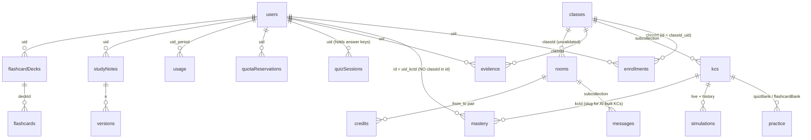

# Database and API Audit (read-only)

Repo: `shamzrepha/synapta` (SunRootLearn), worktree branch `worktree-agent-afc8b1d4a39455d5a`, HEAD `e3eb258`.
Slice: Firestore data model plus all `app/api/**/route.ts` (338 route files). Method: text search and file reading only. Nothing was run, built, deployed or called. No secret values were read or printed.

Evidence legend: **Verified** = read in code this session. **Partially verified** = code read, but behaviour depends on something not visible (Firestore server behaviour, Console settings). **Assumption** = inferred. **Unknown** = cannot be determined from the repo. Confidence: HIGH / MEDIUM / LOW / UNKNOWN.

---

# PART 1 - DATABASE

## 1.1 Headline numbers

- About 165 distinct collection or subcollection names are used in server code (`.collection("...")` search), plus about 12 held in constants (`studyNotes`, `mindMaps`, `studyGoals`, `reportShares`, `snapHistory`, `experimentRuns`, `paperAttempts`, `circuitDebugs`, `translations`) and 2 with underscores (`friend_requests`, `direct_chats`). No `collectionGroup` queries exist (Verified: zero hits).
- `firestore.rules` (257 lines) declares rules for about 28 of them. Everything else falls under `match /{document=**} { allow read, write: if false; }`, i.e. server-only through firebase-admin. This is a sound default.
- Only **three** places in the client use the Firestore SDK: `app/(app)/lounge/[roomCode]/page.tsx` (`rooms/{code}` and `rooms/{code}/messages`), `components/providers/realtime-provider.tsx` (`userSignals/{uid}`), `lib/live/client.ts` (`liveChannels/*`). So the rules matter directly only for those paths. Every other read or write goes through API routes using the admin SDK (rules bypassed), which means **API-level authorization is the real security boundary**.
- `firestore.indexes.json`: 28 composite indexes, `fieldOverrides: []`. No TTL policy is declared in the repo (TTL is a Console setting, see D8).

## 1.2 Collection inventory

Rules column: R-own = owner read, R-staff = class teacher/admin read, R-enr = enrolled read, "deny" = falls into default deny (server only). "Idx" = composite index present in `firestore.indexes.json`.

### Core learning domain

| Collection (path) | Purpose | Key fields (from writers) | Writers | Rules (client) | Idx / main queries | Retention / growth |
|---|---|---|---|---|---|---|
| `users/{uid}` | Profile, role, XP, streak, token counters, plan | `uid,email,displayName,displayNameLower,username,photoURL,role,roleRequest,xp,streakDays,streakFreezes,lastActiveDate,monthlyTokenLimit,monthlyTokensUsed,usagePeriod,disabled,profileSetup,institution,department,level,interests,plan,planTerm,planExpiresAt,featureUsage{period:{feature:n}}` (`app/api/auth/bootstrap`, `lib/quota/guard.ts`, `lib/billing/*`, `lib/evidence/apply.ts`) | API, admin | read own/admin; write false | single-field only; `username ==`; `xp desc` leaderboard | One doc per user forever. No delete flow (D9). |
| `classes/{classId}` | Classroom | `id,title,subject,description,level,institution,department,audienceTags[],durationWeeks,teacherId,coTeacherIds[],teacherName(denorm),visibility,status,buildState,audioLessons,narratorVoice,recommendedPlan,joinCode,studentCount(denorm counter),build*,createdAt,updatedAt` (`app/api/classes/route.ts`, `lib/types/course.ts`, `lib/validation/classes.ts`) | teacher via API | read if public+published, teacher, or enrolled; write false | idx (visibility,status,createdAt), (teacherId,createdAt); `coTeacherIds array-contains`, `joinCode ==` | Grows with teachers. DELETE removes only this doc (D1). |
| `classes/{c}/kcs/{kcId}` | Knowledge components (topics), the unit of mastery | `id,title,description,order,week,objectives[],prerequisiteIds[],bkt{pL0,pT,pG,pS},status draft/published,source,sourceMaterialIds,parentId,difficulty,lab,aliases,contentVersion,contentPublished{},lessonMarkdown` (`lib/teacher/classBuilder.ts`, `app/api/classes/[id]/kcs/route.ts`) | teacher / AI builder | enrolled read (published) / staff read | `orderBy order`; read in full by ~10 routes | Tens to low hundreds per class. **AI-built KCs use stable slug ids** (D3). |
| `classes/{c}/kcs/{k}/{audio,quests,practice,pieces,simulations,live,glossary}` | Per-topic generated content: audio turns, quiz and flashcard banks (`practice/quizBank`, `practice/flashcardBank`), sim pieces, simulation, live state | banks hold `questions[]`/`cards[]` arrays; simulation holds `html`, `status`, `generationStartedAt` (`lib/practice/bank.ts`, `lib/sim/store.ts`) | AI pipeline | no rule (deny) | doc-id reads | Doc-size risk (1 MiB) for `html` and banks; simulation history docs exist. |
| `classes/{c}/materials/{m}` (+`chunks`) | Teacher uploads and extracted text | `title,type,status,extractedText?,storagePath,pageCount,proposalId` | teacher | staff read | `orderBy createdAt` | `extractedText` can be large (D6). |
| `classes/{c}/materialJobs`, `buildJobs`, `mapProposals`, `assignments`, `pastQuestions`, `labs` | Async work state, proposals, assignments | `status` (running/waiting_quota/completed/failed), `step`, `pct`, `proposalId`, `error` | server | rules exist for `buildJobs`, `mapProposals`, `assignments`; none for `materialJobs`, `pastQuestions` | none | Unbounded history, no TTL. |
| `enrollments/{classId}_{uid}` | Membership, deterministic id | `classId,uid,userEmail(denorm),status active/pending/rejected,role?,joinedAt,updatedAt` (`app/api/classes/[id]/join`) | API (transaction) | read own/admin; write false; also used by rules `isEnrolled` | idx (uid,status), (classId,status) | One per (class,student), never deleted. |
| `mastery/{uid}_{kcId}` | BKT state per learner per topic | `uid,classId,kcId,pL,attempts,correct,lastUpdated,lastPracticedAt,stability,nextReviewAt,lastLabAt,flashcardCountToday,lastFlashcardDate,masteryBonusAwardedAt` (`lib/evidence/apply.ts`) | server only | read own/admin | equality queries on uid, classId, (classId,kcId) | students x topics. **Id has no classId** (D3). |
| `evidence/{auto}` | Immutable log of each graded interaction | `uid,classId,kcId,activity,correct,omega,pLBefore,pLAfter,xpEarned,metadata{},createdAt` | `applyEvidence` | read own/admin | idx (uid,kcId,createdAt desc) | **Fastest-growing collection**, no TTL or roll-up. |
| `quizSessions/{auto}` | A learner's active quiz, **holds answer keys** | `sessionId,uid,classId,kcId,questions[{question,options,correctIndex,explanation}],answered{idx:{...}},createdAt(JS Date)` | server | no rule: deny (correct, it holds answers) | doc-id | One per quiz, no TTL, no completion fields. |
| `learnerProfiles/{uid}`, `misconceptions/{auto}`, `kcMisconceptionCatalog/{id}/items`, `userSignals/{uid}`, `classSignals/{classId}`, `liveChannels/*` | Adaptive state and realtime pings | aggregates, per-uid misconceptions, counters/timestamps only | server | own / enrolled / any-signed-in (`liveChannels`) | none | small, overwritten |
| `learnerPlans/{uid}_{classId}_{yyyy-mm-dd}` | Cached daily AI teacher note (`classes/[id]/map`) | `note,todayFocusKcId` | server | deny | doc-id | **One doc per learner per class per day, no TTL** (D5). |
| `contentCache/{hash}` | Cached AI lesson content per class | `classId,status,cacheHits,createdAt` | server | deny | query `classId ==` + `orderBy createdAt desc`: **no index** (D4) | grows per generation |
| `aiCache/{key}` (also `ttsCache`, `videoCache`, `translations`) | AI response caches | `text,data,modelUsed,createdAt` (ISO **string**) (`lib/ai/router.ts`) | server | deny | doc-id | **No expiry or TTL field.** |
| `studyNotes/{auto}` (+`versions`) | AI notes with version history | `uid,title,sourceTitle,sourceText(<=150k chars),head,practice,teachScript`; versions: `n,markdown,instruction,createdAt` | owner via API | deny | `uid ==` | Capped at 60 notes per user; versions pruned to `MAX_VERSIONS`. |
| `flashcardDecks`, `flashcards`, `flashcardStats/{uid}`, `users/{uid}/cards`, `reviewLogs` | Personal spaced repetition | deck meta; card `uid,deckId,front,back,fsrs`; stats `total,byDay{date:n}` | owner | deny | `uid ==` | max 20 decks x 100 cards per user; `byDay` map grows 1 key per day. |
| `mistakes`, `explainers`, `notebooks`(+`sources`,`messages`), `mindMaps`, `snapHistory`, `paperAttempts`, `pastQuestionAttempts`, `examPlans`, `studyGoals`, `lessonPlans`, `dailyChallenges`, `quests`, `questRuns`, `focusSessions`, `focusRooms` | Personal study artifacts | per-uid | owner | deny | mostly `uid ==` (+`createdAt`) | per-user, only capped where the route caps it |

### Social, community, gamification (all deny except where noted)

`posts`(+`reactions`,`comments`,`pollVotes`), `communities`(+`posts`,`members`), `users/{uid}/friends`, `friend_requests`, `direct_chats`, `chats`(+`messages`), `messages`, `studyGroups`(+`activity`), `polls`(+`votes`,`comments`), `askQuestions`(+`replies`,`clarityVotes`), `shoutouts`, `hashtagStats`, `bookmarks`, `following`/`followers`, `users/{uid}/notifications` (R-own), `pushTokens`, `pendingShares`, `leagueEntries`, `leagueCohorts`, `weeklyBoards`(+`entries`), `weeklyReports`, `seasonProgress`, `shopLedger`, `studioContests`, `designs`(+`commits`,`stars`,`versions`), `events`(+`entries`), `studySessions`, `attendanceSessions`/`attendanceCheckins`, `classAnnouncements`/`announcementReads`, `tutorProfiles`/`tutorRequests`/`tutorThreads`, `mentorProfiles`/`mentorRequests`/`checkins`, `gradingSets`/`gradingSubmissions`, `schools`, `institutionInquiries`, `bugReports` (R-own), `reports`.
Indexes present for `posts` (6), `designs` (4), `events` (2), `chats`/`notebooks`/`designs` (`memberIds` contains + `updatedAt`), `leagueEntries` (3), `studySessions`, `bugReports`, `reports`, `auditLogs`, `worlds`, `jobs`.

### Platform and ops

| Collection | Purpose | Notes |
|---|---|---|
| `usage/{uid}_{yyyy-mm}` | Monthly token and cost analytics (`tokensIn,tokensOut,calls,estimatedCostUsd`) | read own. Written in the same transaction as `users.monthlyTokensUsed`. Cost uses Gemini Flash prices for **every** provider (Verified: `applyUsage`), so Groq/OpenRouter spend is mis-estimated. |
| `quotaReservations/{auto}` | Token reservations | `uid,tokens,status open/settled/released,period,createdAtMs,expiresAtMs,purgeAt(+7d),actualTokens`. Rules: deny. |
| `rateLimits/{id}_{bucket}` | Shared fixed-window counters | `count,windowStart,purgeAt`. Rules: deny. |
| `aiSpend`, `aiUsage`, `aiHealth`, `config` (`config/billing`), `systemConfig`, `secrets`, `payments/{reference}` | Spend caps, health, flags, provider keys, payments | `payments` id = Paystack reference (idempotency key). `secrets`/`systemConfig` hold provider keys written by `app/api/admin/system/*-key`; encryption at rest is Unknown (values not read). |
| `auditLogs`, `errorLogs` | Admin logs | `errorLogs.expireAt` (14 d) vs the `purgeAt` field DEPLOY.md documents: **mismatch** (D8). `errorLogs` stores client IP. `auditLogs` has no retention. |
| `worlds`, `jobs`, `sourceDocs`(+`pages`), `knowledge/{worldId}`(+`units,concepts,conflicts,meta,images`), `worlds/{id}/nodes,activities` | SunRoot Worlds pipeline | owner read (and enrolled for class worlds). `knowledge/*` is read in full per world (`lib/worlds/store.ts`). |
| `media/{id}`, `avatars/{uid}` | **Images stored base64 inside Firestore docs** | `lib/media/store.ts` keeps them under the 1 MiB doc cap. Served by `app/api/media/[...path]` and `app/api/avatar/[uid]` with 1-year private cache headers. |
| `diagnosticSessions` | Placement test | explicit `allow read, write: if false` |
| `rooms/{code}` (+`messages`,`presence`,`credits`) | Study Lounge | see D2. |

## 1.3 Rules vs code vs indexes

1. Rules exist for `artifacts` and top-level `sources`/`chunks`, but no code path writes a top-level `artifacts` collection (zero `.collection("artifacts")` hits) and `sources` hits are the notebook subcollection. Likely dead rules (Partially verified).
2. Rules authorise admins by the **custom claim** (`request.auth.token.role == 'admin'`), while the API trusts `users.role` in Firestore. They can diverge up to the ID-token lifetime after a role change. Low impact since clients read only four paths (Verified).
3. The `classes` rule hides private classes from non-members, but `GET /api/classes` explore returns them (D7). Rule and API disagree.
4. The `rooms` rule is member-only, but membership is self-service through the API (D2).
5. Missing or broken indexes (Verified by comparing queries to `firestore.indexes.json`):
   - `contentCache`: `where classId == ... orderBy createdAt desc` in `app/api/classes/[id]/content/route.ts` has no composite index.
   - `evidence`: `app/api/me/dashboard/route.ts` queries `where uid == ... orderBy timestamp desc`; the index is `(uid, kcId, createdAt)` and the writer never writes `timestamp` (see D10). The `.catch(() => null)` hides the error.
6. Not needed: `quotaReservations where uid== and status==`, `friend_requests` equality pairs (equality-only merges).

## 1.4 Mermaid ER (core)

## 1.5 Findings (Finding / Evidence / Status / Impact / Recommendation)

### D1. Class deletion leaves orphans. Verified, HIGH confidence, impact MEDIUM
- Evidence: `DELETE` in `app/api/classes/[id]/route.ts` does `collection("classes").doc(id).delete()` then writes `auditLogs`. Firestore does not delete subcollections. `recursiveDelete` is used for notebooks, events, feed posts, designs, not classes.
- Orphaned: `classes/{id}/kcs|materials|chunks|buildJobs|materialJobs|mapProposals|assignments|pastQuestions`, and top-level `enrollments`, `mastery`, `evidence`, `quizSessions`, `rooms`, `learnerPlans`, `contentCache`, `studySessions`, plus `posts.classId`, `events.classId`.
- Recommendation: soft delete first (`status: "archived"`, `deletedAt`), then a server job using `recursiveDelete` for the subtree and batched deletes by `classId` for the top-level collections.

### D2. Study Lounge isolation is nominal. Verified, HIGH confidence, impact HIGH
- `GET /api/lounge/rooms` returns the 20 most recent rooms **globally** (`orderBy updatedAt desc limit 20`) with `roomCode`, `title`, `classId`, `kcTitle`, `hostName` to any signed-in user.
- `GET /api/lounge/rooms/[roomCode]` **auto-joins** any signed-in caller: appends the uid to `memberIds` and `participants`, posts a "joined" message, then returns messages. With the listing above, any user can enter any room. The code space is 32^4 (about 1.05 M) with no rate limit.
- `POST /api/lounge/rooms` never checks that the creator can access `classId`/`kcId`, and accepts arbitrary `invitedUids` (unbounded, not validated, no consent) which become `memberIds` immediately.
- Join is a non-transactional read-modify-write of arrays (lost updates, duplicates). Room code uniqueness is check-then-set.
- Rules let members read `rooms/{code}/messages` with an unbounded `orderBy createdAt` listener on the client (`lounge/[roomCode]/page.tsx`), so a long-lived room re-reads its entire history on each attach.
- XP farming: `POST .../credit` only requires the caller be in `memberIds` (not enrolled in the class). One credit per (caller,target) pair **per room**, but rooms are unlimited, so two accounts can create rooms and credit each other repeatedly for +40 XP and an omega=2.0 BKT update. The `credits/{from_to}` `get` then `set` is not transactional, so a double submit credits twice.
- Recommendation: list only rooms where `memberIds` contains the caller (new index `rooms (memberIds CONTAINS, updatedAt DESC)`); require `assertClassAccess` or an invite secret to join; no state change on GET; cap and validate `invitedUids`; transactions for join and credit; require both peers enrolled and a daily per-pair cap; `limit(100)` on the listener.

### D3. `mastery` id omits classId and AI-built KC ids are slugs. Verified, HIGH, impact HIGH
- `lib/teacher/classBuilder.ts` writes KCs with `id: slug` (`kcsCollection.doc(kc.id)`, "stable slug IDs"), so two classes can both have KC `ohms-law`. `lib/evidence/apply.ts` writes `mastery/${uid}_${kcId}` with `set(..., {merge: true})` including `classId`. A learner in two such classes shares **one** mastery doc: progress, attempts and the daily flashcard counter bleed across classes, `classId` flips to the last writer, the teacher heatmap (`mastery where classId == id`) loses or mixes rows, and the +100 first-mastery bonus is once per slug.
- Rules gate `mastery` on `resource.data.uid`, so there is no cross-user leak; the damage is integrity.
- Recommendation: new writes use `${uid}_${classId}_${kcId}`; read new id first, fall back to the old id when `old.classId == classId`; idempotent backfill copies old docs to the new id. No new collection needed.

### D4. Missing composite index for `contentCache`. Verified, HIGH, impact MEDIUM
See 1.3. Fix: add `(classId ASC, createdAt DESC)` to `firestore.indexes.json`. The route is also an unbounded read.

### D5. Daily cache docs never expire. Verified, HIGH, impact LOW-MEDIUM
`learnerPlans/{uid}_{classId}_{date}` is created per learner per class per day (`classes/[id]/map`) with no `purgeAt`. Add `purgeAt` (3 days) and a TTL policy.

### D6. Large or hot documents. Partially verified
- `studyNotes.sourceText` holds up to 150,000 characters (`NOTE_SOURCE_MAX` 120,000 x 1.25). Firestore limits bytes, not characters, so multi-byte scripts (Arabic, Chinese, Yoruba diacritics) can approach or exceed the 1 MiB doc limit. Cap bytes or move to a sub-doc.
- `materials.extractedText` and `materialJobs.extractedText` (re-stored per job), question banks, simulation `html`: no size guard seen.
- `rooms` doc holds `participants[]`, `memberIds[]` and the `scratchpad` markdown together and is rewritten on every join.
- `flashcardStats.byDay` grows by one key per day forever.
- `users/{uid}` is a write hot spot: every settled AI call and every `applyEvidence` transaction updates it (Assumption: contention only for heavy parallel use).

### D7. Explore leaks private classes and is not a real query. Verified, HIGH, impact MEDIUM
`GET /api/classes` explore does `collection("classes").limit(50)` (500 for admins) with **no `where` or `orderBy`**, then filters in memory on `status === "published"` only. `visibility` is never checked, so private published classes (title, description, teacher name, institution) are returned to every caller, **including signed-out** ones (the route tolerates a failed `requireUser`); only `joinCode` is hidden. Also the 50-doc cut happens before the filter and without ordering, so explore shows an arbitrary 50 documents and good classes disappear as the collection grows. The index `(visibility,status,createdAt desc)` exists and is the intended query. Recommendation: `where visibility == "public" and status == "published"`, `orderBy createdAt desc`, `limit`, cursor pagination.

### D8. Retention is mostly absent. Verified, HIGH
TTL fields exist only on `rateLimits.purgeAt`, `quotaReservations.purgeAt` and `errorLogs.expireAt`. The TTL policy is a manual Console step documented (DEPLOY.md, docs/DECISIONS.md) only for `rateLimits` and `quotaReservations`; `firestore.indexes.json` has no TTL `fieldOverrides`, so whether TTL is on is **Unknown**. `errorLogs` uses `expireAt`, a different field from the documented `purgeAt`, so following DEPLOY.md leaves it growing (and holding IPs). No retention at all for `evidence`, `quizSessions`, `learnerPlans`, `aiCache`/`contentCache`/`ttsCache`/`videoCache`, `auditLogs`, `usage`, `notifications`, job docs, `messages`. Recommendation: one TTL field name (`purgeAt`) on every ephemeral doc, declared in `firestore.indexes.json` `fieldOverrides`; suggested TTLs: `quizSessions` 7 d after creation, `learnerPlans` 3 d, job docs 30 d, `aiCache` 30 d, `notifications` 90 d.

### D9. No account deletion or data export. Verified (absence), HIGH, impact MEDIUM-HIGH
No `DELETE` handler in `app/api/me/*`, `app/api/users/*`, `app/api/admin/users/*`; no `deleteUser(` call; `recursiveDelete` is never applied to `users/{uid}`. Evidence, mastery, notes, flashcards, chat, `media` and `avatars` cannot be erased on request. Likely a compliance exposure (NDPR/GDPR-type). Recommendation: `DELETE /api/me` that anonymises evidence aggregates and runs `recursiveDelete` over `users/{uid}` plus `where uid ==` batched deletes for user-keyed collections.

### D10. Schema inconsistencies. Verified
- `lib/types/course.ts` `ClassDoc.status` is `"draft"|"published"` and `buildState` `"empty|drafting|ready|failed"`; `createClassSchema` accepts `"archived"` and `"needs_review"`, and `classBuilder` writes `"needs_review"`. The types are wrong.
- `createClassSchema.status` **defaults to `"published"`** (route: `status || (buildState === "drafting" ? "draft" : "published")`), so a class created without an explicit status is immediately public.
- Evidence field names: writer uses `activity, correct, xpEarned, createdAt`; the dashboard reader uses `type, score, xpAwarded, timestamp`, so the "recent activity" panel in `me/dashboard` is always empty (and the index does not match).
- `createdAt` is a `Timestamp` in most places, an ISO string in `aiCache`, a JS `Date` in `quizSessions`, and `createdAtMs` in `communities`. Strings cannot be used for TTL or reliable ordering.

### D11. Denormalised or duplicated data. Verified
`classes.teacherName/institution/department` (copied at creation, stale on rename), `classes.studentCount` (incremented in the join transaction; no decrement path found), `enrollments.userEmail` (PII copy, never refreshed), `rooms.hostName` and `participants[].displayName`, `users.displayNameLower`, `mastery.classId`. Recommendation: treat names as display caches, resolve from `users` for teacher-facing screens, drop `enrollments.userEmail` (roster already uses `getAll` on users).

### D12. Weak tenant isolation. Verified
1. **`POST /api/lounge/match`** (`app/api/lounge/match/route.ts`): takes `classId`/`kcId` from the body, authenticates the caller but never calls `assertClassAccess` or checks enrollment, then returns, for every active student of **any** class: `uid`, `displayName`, **`email`**, `xp`, `streakDays`, mastery `pL`. Any signed-in user can harvest other classes' student emails and performance. Severity HIGH. Fix: `assertClassAccess(caller, classId, "view")` and remove `email`. It also does N single `get()` calls per enrollee instead of `getAll`.
2. `POST /api/lounge/rooms` accepts any `classId` (D2).
3. `ai/quiz` and `ai/flashcards` generate a missing bank **billed to the class owner** (`classOwner(access.classData, caller.uid)`): a student triggers spend on the teacher's quota. Access is checked first, so only members, but the attribution is cross-user.
4. `users/search` reads `users.limit(60)` with no ordering and filters in memory, so search only sees an arbitrary 60 accounts and costs 60 reads per request. `app/api/search/route.ts` already uses an indexed `username >= / <=` prefix query; reuse it.
5. Rules let enrolled students read published KC docs directly with the SDK. If KC docs carry teacher-only fields (draft lesson text, lab answer keys) they are exposed (Assumption: not fully reviewed).

### D13. Unbounded or expensive queries. Verified by script scan
A scan for `collection(x)...get()` chains with no `.limit()` in `app/api` and `lib` returned 73 hits. Those that scale with users or data:

| Query | File | Risk |
|---|---|---|
| whole `classes` | `app/api/jobs/resume/route.ts` (admin batch) | O(all classes), plus sequential per-class job reads, 60 s function |
| `enrollments where classId ==` (+status) | `classes/[id]/roster`, `heatmap`, `lounge/match`, `lib/classes/members.ts`, `lib/teach/roster.ts` | O(class size) per view |
| `mastery where classId ==` | `classes/[id]/heatmap` | O(students x topics) in one request (e.g. 500 x 40 = 20k reads) |
| `mastery where uid ==` | `me/dashboard` | O(topics ever studied) per dashboard load |
| `enrollments where uid ==` (no status) | `classes` GET explore | all history of the user |
| `kcs` full collection | about 10 routes | fine until classes have hundreds of topics |
| `assignments`, `materials`, `mapProposals`, `pastQuestions`, `contentCache` lists | class routes | no pagination |
| `users.limit(60)` | `users/search` | 60 reads per request |
| `friends` full subcollection | `friends`, `users/search` | per user |
| `entries` whole subcollection | `lib/events/store.ts`, `studio/contests/[id]` | O(participants) |
| worlds `activities/nodes/units/concepts` | `lib/worlds/*` | O(world size) |

Pagination: only `limit(N)` caps were found (`rooms 20`, `messages 60`, `classes 50/500`); no cursor pagination in the routes scanned (Partially verified).
Recommendation: maintain per-class aggregates (an existing `classSignals/{classId}` doc or a new `stats` field on it) inside `applyEvidence` so the heatmap reads one doc plus a paged roster.

## 1.6 Data flows and transactionality

| Flow | Steps | Atomic? | Gaps |
|---|---|---|---|
| **Registration** `POST /api/auth/bootstrap` | in-memory rate limit, `verifyIdToken` (no revocation check), username probe (`where username ==`, up to 6 tries), `userRef.set` (new) or `update`, `recordActivityDay`, `setCustomUserClaims` | **No.** The exists-check plus `set()` is not a transaction (two tabs can both create; second overwrites the first). Username uniqueness is check-then-write with no reservation doc, so simultaneous sign-ups can take the same handle. | `roleRequest: "pending"` from the **request body** gives `TEACHER_TOKEN_LIMIT` (200k default) instead of 50k before any approval. The 500 response returns the raw `err.message`. |
| **Teacher creates class** `POST /api/classes` | `requireUser(["teacher","admin"])`, zod, read `users`, `joinCode` (up to 3 uniqueness probes), `classRef.set` | One write, atomic. `joinCode` uniqueness is check-then-set; after 3 collisions the last code is used anyway. | No rate limit on creation (no `checkRateLimit` in the file). Default status published. |
| **Publish class** `POST /api/classes/[id]/publish` | read all KCs, cycle check, **batch** (KCs and class to published), then `pushClassContent` (separate), then notifications | Status flip is one batch. Content push and notifications are separate best-effort steps (`.catch`). | A class can be "published" with unpublished content (response lists `skipped`). Batch cap of 500 writes. No idempotency: a double click re-notifies all students. |
| **Student enrolls** `POST /api/classes/[id]/join` | in-memory rate limit 10/min, **transaction**: read class and enrollment, set enrollment, `studentCount++` | **Yes, good.** | `rejected` (or removed) enrollment on a **public** class is auto-readmitted: only `active` and `pending` short-circuit, then `autoAdmit = isPublic || ...` sets `active`. Counter never decremented in this route. |
| **Quiz** `POST /api/ai/quiz` then `POST /api/quiz/[sessionId]/answer` | session doc with answer keys; per answer a **transaction** locks `answered.{idx}`; then `applyEvidenceIfEnrolled`; mistakes recorded best-effort | Answer lock is atomic (no double scoring). **Lock and evidence are separate steps**: if evidence fails for a reason other than NOT_ENROLLED, the answer stays locked with no mastery or XP and no retry path. | No "quiz completed" write (no score summary). |
| **Mastery update** `applyEvidence` | one transaction: enrollment active check, KC read, mastery read, user read; writes mastery, evidence, user XP and streak; then `trackProgress`, notifications, `shareAchievement` outside | **Yes for the core.** Daily flashcard cap (30/KC) and lab cooldown (10 min) live in the mastery doc. | `kc.status` is not checked (evidence on draft KCs). Flashcard `correct` is client-asserted (`POST /api/evidence`). Gamification after commit can fail silently (by design). |
| **AI notes** `POST /api/study/notes` | in-memory limit 6/min, zod, count notes (<60), `checkFeature`, `checkRateLimitAndQuota`, `generateWithFallback` (reserve, call, settle or release), `doc().set`, `addVersion` (transaction), `recordFeature` | Quota reserve/settle is transactional and idempotent. | 60-note cap and feature limit are check-then-act (parallel requests all pass and all spend). Note and version 1 are two writes (a crash leaves `head: 0`). |
| **Flashcards** `POST /api/flashcards` | in-memory limit 8/h, deck count check, AI generation, one **batch** (deck and up to 30 cards) | Batch atomic. | Deck cap check-then-act; review updates card and `flashcardStats` in separate writes. |
| **Study room** | create (`set`), join (GET auto-join + `update`), message (`add`), credit (`get`, `set`, `applyEvidence`) | **None transactional.** | See D2. |
| **AI simulation** `POST .../kcs/[kcId]/simulation` | `assertClassAccess(view)`, in-memory limit 10/h, `checkRateLimitAndQuota`, **transaction** sets `status: generating` lock (409 if generating or exists without `allowReplace`), generate, history snapshot, final `set` | Lock is transactional (good duplicate protection, self-heals after `GENERATION_LOCK_MS`). | Students can create the first sim; spend goes to the student's quota. |
| **Payment** `activatePayment` | transaction: skip if `payments/{reference}` exists; write payment; update plan | **Yes, idempotent by reference** (webhook and redirect verify are both safe). | none |

## 1.7 Data-model recommendations (extend existing structures first)

| # | Where | Proposed change | Why | Compatibility / migration | Index / rules |
|---|---|---|---|---|---|
| 1 | `mastery` | id `${uid}_${classId}_${kcId}`, keep `classId` | D3 | dual read with fallback; idempotent backfill; new writes to new id only | existing equality queries unchanged; rules unchanged |
| 2 | `enrollments` | add `removedAt`, `decidedBy`, `decidedAt`; stop auto-readmitting `rejected` | join policy hole | additive, missing = null | none |
| 3 | `classes` | add `deletedAt`; use `status: "archived"` (already in zod); explore filters `visibility == "public"` | D1, D7 | additive | existing `(visibility,status,createdAt)` serves it |
| 4 | `rooms` | add `inviteSecret` (or class access check), `closedAt`, `memberCount`; move `participants[]` to `rooms/{code}/presence/{uid}` (subcollection already exists) | D2, doc growth | dual read, lazy migrate on next join | new index `rooms (memberIds CONTAINS, updatedAt DESC)`; messages rule is already member-gated |
| 5 | `quizSessions` | add `completedAt`, `score`, `purgeAt` | no completion record, no retention | additive | TTL on `purgeAt` |
| 6 | `evidence` | add `purgeAt` (or roll up old rows into `mastery`); fix the dashboard reader to use `activity/xpEarned/createdAt` | D8, D10 | additive | index `(uid, createdAt DESC)` |
| 7 | `learnerPlans`, `aiCache`, `contentCache`, `ttsCache`, `errorLogs` | add `purgeAt` (and write `purgeAt` instead of `expireAt` on `errorLogs`) | D5, D8 | additive | TTL `fieldOverrides` in `firestore.indexes.json` |
| 8 | `contentCache` | composite index `(classId ASC, createdAt DESC)` | D4 | none | `firestore.indexes.json` |
| 9 | `usage` | add `byProvider` map and per-provider prices | wrong estimates | additive | none |
| 10 | NEW `usernames/{handle}` -> `{uid}` | the one new collection justified: Firestore has no unique constraint, so handle uniqueness needs a reservation doc written in the bootstrap transaction | handle race | backfill from `users.username` | rules deny; server only |
| 11 | `classSignals` (existing) | add per-class aggregates (active students, average pL per KC) maintained in `applyEvidence` | D13 heatmap scans | start empty, rebuild lazily | existing rule already gates reads to enrolled/staff (check it exposes no per-student data) |

---

# PART 2 - API

338 route files under `app/api`. Script counts (regex based, indicative): 328 call `requireUser`; 10 do not (2.10); about 145 reference `checkRateLimit`; about 79 touch AI code; about 117 routes exporting POST/PUT/PATCH/DELETE have **no route-level rate limit** (only the proxy baseline).

## 2.1 Authentication (`lib/auth/requireUser.ts`). Verified

- Accepts `Authorization: Bearer <Firebase ID token>` (preferred) **or** the `__session` cookie (Firebase session cookie, 14 days, `httpOnly`, `sameSite: lax`, `secure` in production).
- Uses `verifyIdToken(token, true)` and `verifySessionCookie(cookie, true)`: **`checkRevoked = true`**, so each request adds a Firebase Auth revocation round trip.
- Then one Firestore read `users/{uid}` on **every** request: `disabled === true` gives 403, and the role is **overridden by `users.role`** (the custom claim is not trusted for API authorization).
- If the Firestore lookup fails, privileged requests (any `allowedRoles`, or role other than student) fail closed with 503 `AUTH_UNAVAILABLE`; student requests continue using the claim role (default `student`). If the user doc does not exist, the request proceeds as student.
- Role check: `allowedRoles.includes(role)` else 403. Roles are `student | teacher | admin`; there is no `principal` role in `requireUser` (school/principal logic is inside `app/api/schools`, not audited in depth).
- `requireVerifiedEmail(user)` blocks email/password users who have not verified, for user-visible content.
- CSRF: `proxy.ts` calls `isCrossSiteWrite`, refusing writes whose `Origin` host differs from `Host`; a missing `Origin` is allowed (curl, cron, native). Cookie auth + `sameSite=lax` + Origin check is acceptable.
- Body size: `proxy.ts` rejects a declared `content-length` above 26 MB. Chunked bodies without `content-length` are not caught here (Assumption: runtime limits then apply).

## 2.2 Authorization helpers

- **`assertClassAccess(user, classId, mode)`** (`lib/auth/classAccess.ts`): 2 reads (`classes/{id}`, `enrollments/{classId}_{uid}`), computes `isOwner` (teacherId or coTeacherIds), `isAdmin`, `isEnrolled` (only `status === "active"`), `canView = owner || admin || enrolled`, `canMutate = owner || admin`; mode `mutate` throws 403. Used across `classes/[id]/*`. **Not used** in `lounge/match` and `lounge/rooms` (D2, D12).
- **Admin**: `requireUser(req, ["admin"])` or `requireAdmin`. `route-guards.test.ts` checks each handler in `app/api/admin/**` (admin checks >= handlers).
- **Teacher**: `requireUser(req, ["teacher","admin"])` on creation and AI-build routes; per-class ownership via `assertClassAccess(..., "mutate")`.
- Weakness of the CI test: it matches **regex over source text** (`requireUser|requireAdmin|requireTeacher|requireVerifiedEmail|verifySessionCookie|verifyIdToken|x-paystack-signature|CRON_SECRET|requireCaller|requireRole|loadChatForMember|getCaller`). A comment containing one of those words passes. A route that guards one handler but not another passes (the per-handler count applies only to admin routes). It does not test authorization, rate limiting, validation or query limits.

## 2.3 Validation and error contract

- Contract (`lib/api/errors.ts`): `{ ok: false, error: { code, message, requestId? } }`, success `{ ok: true, data }`. `toErrorResponse` handles `ApiError` (status, code, headers), `ZodError` (400 `VALIDATION`), JSON syntax errors (400 `BAD_JSON`), `AI_QUOTA_EXHAUSTED` (429 with Retry-After), duck-typed 4xx errors, and masks everything else as 500 `INTERNAL` with a `requestId`. `parseJson(req, schema)` throws `ApiError(400)`.
- Adoption is **inconsistent**: many routes hand-roll the JSON, and some call `req.json()` without a catch (`lounge/rooms` POST and `lounge/rooms/[roomCode]/messages` POST: malformed JSON becomes a generic 500). `auth/bootstrap` returns the raw `err.message` in 500s (no masking).
- A loose scan finds about 112 route files with no zod reference; many are GET or DELETE with path ids only, and path ids are often not regex-validated (`roomCode`, `friendUid`).
- Weak validation (Verified): `lounge/rooms` POST (`classId`, `kcId`, `kcTitle`, `invitedUids` unbounded), `createClassSchema.audienceTags` (unbounded strings) and `recommendedPlan` (`z.record(z.unknown())`, size checked only in the route), `bootstrap` (an invalid body silently becomes defaults), `lounge/rooms/[roomCode]` GET changes state.

## 2.4 Rate limiting: exact behaviour

Three layers exist. **`docs/DECISIONS.md` overstates how much is shared.**

1. **Proxy baseline** (`proxy.ts`, `lib/security/api-guard.ts`): every POST/PUT/PATCH/DELETE to `/api/*` gets 240/min for a signed-in credential key (tail of cookie or bearer) or 60/min anonymous (by IP). **In memory, per server instance.**
2. **`checkRateLimit(req, {keyPrefix, limit, windowMs, uid?, shared?})`** (`lib/rateLimit.ts`): key is `user:{uid}:{prefix}` when `uid` is passed, else `ip:{first x-forwarded-for}:{prefix}`. Without `shared` it uses `evaluateRateLimit`, a sliding window in a module-level `Map`: **per serverless instance or process, reset on cold start, not shared**. With `shared: true` it uses `evaluateSharedRateLimit`: a Firestore doc `rateLimits/{id}_{bucket}` incremented in a transaction (fixed window, up to 2x burst at a boundary, `purgeAt` for TTL). On any Firestore error it **falls back to the in-memory limiter** and only logs `console.error`.
3. **`checkRateLimitAndQuota(uid, estimate)`** (`lib/quota/guard.ts`): **always shared** (`evaluateSharedRateLimit("user:{uid}:ai", perMinute, 60s)`; 10/min students, 60/min teachers/admins, or the plan value when billing is enforced), then a read-only budget check. This is the only AI per-minute limiter that holds across instances. It does not reserve; reservation happens inside `generateWithFallback` (`reserveQuota`).

Who uses what (Verified by search):
- **Shared via `checkRateLimit({shared: true})`**: only 9 route files: `admin/system/ai-key`, `admin/system/groq-key`, `admin/system/openrouter-key`, `institutions/inquiry`, `events` (daily create), `classes/[id]/past-questions` (grade/solve/scan day caps), `stt`, `schools` (public registration, create, announce), `i18n/ui`.
- **Shared per-minute AI via the quota guard**: about 35 call sites (`notebook/*`, `study/notes*`, `study/glossary|term|terms|evaluation`, `papers*`, `mindmap/*`, `snap`, `teach`, `documents/read`, `classes/[id]/syllabus/generate`, `diagnostic/start`, `kcs/[kcId]/content/generate`, `kcs/[kcId]/profile`, and library callers `lesson/generate`, `lesson/audio`, `sim/store`, `sim/pieces`, `quest/store`, `teacher/orchestrator`).
- **In-memory only** (every other `checkRateLimit` caller, about 136 routes): `auth/bootstrap` (30/min/IP), `auth/session` (20/min/IP), `classes/[id]/join` (10/min/uid), `ai/quiz` (20/min), `study/notes` (6/min), `flashcards` (8/h), `sim-build` (10/h), `users/search` (20/min), `client-errors` (10/min/IP), `me/*`, social routes.
- **No route-level limit** on about 117 mutating routes, for example `classes` POST (create class), `lounge/rooms` POST, `lounge/rooms/[roomCode]/messages`, `lounge/rooms/[roomCode]/credit`, `evidence`, `quiz/[sessionId]/answer`, `classes/[id]/publish` (regex-derived).

Meaning of in-memory limits:
- **One long-lived server** (the Docker/standalone self-host in `Dockerfile` and `docs/SELF-HOSTING.md`): correct for one process, lost on restart; with N replicas or a cluster the effective limit is N times the limit.
- **Vercel** (production per CLAUDE.md, `main` auto-deploys): each warm lambda instance has its own `Map` and cold starts reset it, so the real limit for a determined client is `limit x warm instances`, effectively unbounded for abuse. `x-forwarded-for` is trusted (first entry); on Vercel the platform sets it, behind a self-managed proxy it may be client-supplied (Unknown for the Coolify/Cloudflare set-up).
- `docs/DECISIONS.md` says the "AI rate limits ... and the auth-session limit use a shared fixed-window counter". True for AI via `checkRateLimitAndQuota`; **false for the auth-session limit**: `auth/session` calls `checkRateLimit` without `shared: true` (Verified).

## 2.5 Quota reservations (`lib/quota/guard.ts`, used by `generateWithFallback` in `lib/ai/router.ts`)

Flow: (1) `getSiteConfig().aiPaused` kill switch gives 503; (2) `reserveQuota(uid, estimate)` runs a **transaction**: read `users/{uid}`, query open `quotaReservations` for the uid (ignoring expired), reject 429 `QUOTA_EXCEEDED` if `used + outstanding + estimate > limit`, otherwise create a reservation (`expiresAtMs = now + 10 min`, `purgeAt = +7 d`); admins, and teachers while billing is not enforced, get `id: null` and no reservation; (3) the model call; (4) `settleQuota` (transaction, only if still `open`: updates `users.monthlyTokensUsed` and `usage/{uid}_{period}`, marks `settled`) or `releaseQuota` (only if `open`). Cached answers (0 tokens) are released.
- **Idempotency**: settle and release act only on `status === "open"`, so retries never double-charge (Verified; covered by `lib/quota/reservation.test.ts`).
- **Race safety**: reserve is one transaction over the user doc and the open-reservation query. Under Firestore's server-side transaction locking, concurrent reserves for one user should serialise. **Partially verified**: `reservation.test.ts` uses an in-memory fake that runs transactions one at a time, so it proves the logic, not real concurrency. Settlement can exceed the estimate: `applyUsage` does not re-check the limit, so each call can overshoot by (actual minus estimate).
- **Free usage on settle failure**: if `settleQuota` throws after generation, the reservation stays open until it expires (10 min) and then stops counting, but the tokens were never added to `monthlyTokensUsed`. The user gets the answer and is not charged (Verified from code and comment).
- **Gaps (money)**: (a) `recordTokenUsage` (no reservation, post-paid) is used by `classes/[id]/syllabus/generate`, `diagnostic/start` and `classes/[id]/map`; the first two are preceded by `checkRateLimitAndQuota`, but `classes/[id]/map` has **no** check at all (2.9). (b) Teachers are uncapped monthly while billing is not enforced (and have a 10 M default otherwise): a compromised teacher account has no spend ceiling beyond 60 calls/min. (c) `bootstrap` gives self-declared "pending teachers" 200k tokens. (d) cost estimates are Gemini-priced for all providers. (e) `checkRateLimitAndQuota` and `reserveQuota` each read the user doc and the reservations query, so every AI call does the same budget work twice.

## 2.6 Async jobs and background tasks

- No queue. Long work runs **inside the request** with large `maxDuration` (77 routes set it; `classes/[id]/build` 300 s, `ai/quiz` 120 s, `study/notes` 120 s, `jobs/resume` 60 s). Progress is persisted as Firestore state: `classes/{c}/buildJobs/{jobId}` (`step, pct, status running/waiting_quota/completed/failed`), `materialJobs`, top-level `jobs/{id}` (worlds), the simulation `status: generating` lock.
- Resumption: `POST /api/jobs/resume` (teacher/admin) resumes one job (`classId + jobId + jobType`) or batch-scans classes for `waiting_quota` jobs. It is **user-triggered**, not scheduled. A build job runs only for the user who started it (`mayRunBuild`). The batch scan is O(classes) with sequential per-class reads; the admin variant reads the **whole `classes` collection**. There is no lease: the transition to `running` is an unconditional `update`, so two actors can resume the same job concurrently (Verified for the material path).
- Scheduled jobs: `vercel.json` registers only `/api/jobs/streak-reminders` (daily 18:00 UTC) and `/api/goals/reminders` (daily 07:00 UTC). `/api/jobs/session-reminders` exists but is **not scheduled** (its comment says reminders are also sent lazily when sessions are viewed). All three authenticate with `Authorization: Bearer $CRON_SECRET` through `isCronAuthorized` (timing-safe compare; no secret configured means no access).
- Work after the response: `api/evidence` does `void recordAdaptiveSignal(...)` and `applyEvidenceIfEnrolled` fires an un-awaited dynamic import chain. On serverless, un-awaited work can be frozen after the response (Assumption), losing adaptive signals.

## 2.7 Idempotency and transactions

| Operation | Idempotent? | Mechanism |
|---|---|---|
| Payment activation | Yes | `payments/{reference}` existence check in a transaction |
| Quota settle / release | Yes | `status === "open"` guard |
| Class join | Yes | deterministic `enrollments/{classId}_{uid}` + transaction |
| Quiz answer | Yes | `answered.{idx}` locked in a transaction, repeat returns stored result |
| Sim generation | Lock | `generating` transaction, 409 on repeat |
| Rate-limit counter | Atomic | transaction on the `rateLimits` doc |
| Create class / room / note / deck / bootstrap / publish / credit / friend request | **No** | no idempotency key accepted anywhere (search for `Idempotency-Key` found none) |
| `POST /api/evidence` (flashcard) | No | each call appends an evidence doc and moves BKT; only the 30/day/KC cap limits repeats |

## 2.8 API SECURITY MATRIX

AuthN: R = `requireUser`. Rate: M = in-memory per instance, S = shared Firestore counter, Q = shared per-minute + token reservation, P = proxy baseline only.

| API category | Authentication | Authorization | Validation | Rate limit | Quota | Main risks |
|---|---|---|---|---|---|---|
| `auth/*` (bootstrap, session, restore) | token verified inline (no `requireUser`); no revocation check in bootstrap | n/a | zod (bootstrap lenient) | M (30/min and 20/min per IP) | none | create race; handle race; body-trusted `roleRequest` grants 200k tokens; raw error text in 500; per-instance limit |
| `classes` (create, list, get, update, delete; 55 files) | R; teacher/admin for writes | `assertClassAccess` view/mutate | zod on create/update | mostly none (P) | none | explore leaks private classes; delete leaves orphans; unlimited creation; default status published |
| `classes/[id]/join`, `roster`, `requests` | R | roster/requests: staff; join: any user | zod | M (join 10/min) | none | rejected students readmitted to public classes; counter drift; roster O(class size) |
| Class AI build (`build`, `syllabus/generate`, `kcs/[kcId]/content/generate`, `diagnostic/start`, `materials`) | R teacher/admin | mutate | zod/parsers | Q | router reservation or post-paid `recordTokenUsage` | teachers uncapped; post-paid routes; 300 s functions; no job lease |
| `classes/[id]/map` | R | view | none needed | none | **none (AI call, post-paid)** | any member can trigger one AI call per day per class with no rate limit or reservation |
| `ai/quiz`, `ai/flashcards`, `quiz/[id]/answer`, `evidence`, `kcs/[kcId]/practice` | R | `assertClassAccess` view; enrollment in `applyEvidence` | zod | M | bank generation billed to class owner | client-asserted `correct`; two-step answer lock then evidence; spend attribution |
| `study/*`, `notebook*`, `papers*`, `mindmap*`, `snap`, `documents/read`, `teach` (AI) | R | owner-scoped | zod, large text caps | Q (+M) | reservation | check-then-act caps; large payloads (notes schema allows 1M chars) |
| `flashcards*` | R | owner | zod | M | router for generation | deck/card cap race |
| `lounge/*` | R | **none for membership** (auto-join, global listing, `match` without class check) | partial zod; unguarded `req.json()` | none | none | private-room bypass; student email and performance leak; XP farming; non-transactional membership |
| Social (`feed`, `communities`, `polls`, `chats`, `messages`, `friends`, `shoutouts`, `hashtags`, `mentions`, `ask`) | R (+verified email for content) | author/member checks per route (not all read) | zod mostly | M | none | spam bounded only per instance; `users/search` O(60) reads and wrong results; full-subcollection reads |
| `studio/*`, `worlds/*`, `explainers`, `images`, `tts`, `stt`, `uploads`, `media` | R | owner / class member | zod, multipart | M; S for `stt`, `worlds`, `worlds/docs` | router for AI, none for media | 25 MB multipart (explainers), base64-in-Firestore media, AI spend in `studio/debug`, `worlds/*` |
| `me/*`, `profile`, `settings`, `avatar`, `notifications`, `bookmarks`, `activity`, `streak`, `shop`, `quests`, `pet`, `plans`, `goals`, `referrals` | R | self only (uid from token) | zod mostly | M | none | `me/dashboard` unbounded reads and an always-empty evidence panel; referral abuse (Unknown) |
| `leaderboard`, `schools`, `events`, `sessions`, `attendance`, `announcements`, `grading`, `tutors`, `mentors`, `diagnostic`, `experiments`, `labs`, `report(s)`, `search`, `site`, `i18n`, `institutions` | R | role or ownership checks | zod | M; S for `schools`, `events`, `i18n`, `institutions/inquiry` | AI in `grading/submit`, `i18n` via router | grading and school/principal flows not audited in depth; leaderboard `users orderBy xp` |
| `billing/*` | R (checkout, verify, me); webhook by HMAC | uid from token (enforced by test) | zod | none (P) | n/a | webhook idempotent by reference; verify is the redirect fallback |
| `admin/*` (30 routes) | R + admin enforced per handler by test | admin | zod | S on key routes, none on others | key routes limited | provider keys handled in `admin/system/*-key` (storage encryption Unknown); unbounded admin reads |
| `jobs/*`, `goals/reminders` | `CRON_SECRET` bearer (`jobs/resume` uses R teacher/admin) | secret / ownership | none | none | none | `session-reminders` unscheduled; secret rotation procedure Unknown |
| `health`, `version`, `client-errors` | public | n/a | zod (client-errors) | M (client-errors) | none | `client-errors` writes IP + message unauthenticated, per-instance limit only |

## 2.9 Explicit lists

### Routes without adequate authentication or authorization (Verified unless noted)
1. `POST /api/lounge/match`: authenticated but no class membership check; returns other students' email, XP, streak, mastery for any `classId`.
2. `GET /api/lounge/rooms`: lists every room's code, title, class and host to any signed-in user.
3. `GET /api/lounge/rooms/[roomCode]`: a GET that grants membership to anyone with a code.
4. `POST /api/lounge/rooms`: no check that the creator belongs to `classId`; arbitrary `invitedUids` become members.
5. `POST /api/lounge/rooms/[roomCode]/credit`: the caller need not be enrolled in the class.
6. `GET /api/classes` (explore): returns **private** published classes, also to signed-out callers.
7. `POST /api/classes/[id]/join`: a `rejected` enrollment on a public class is reactivated.
8. `POST /api/jobs/resume`: no job lease; two actors can run the same job.
9. Public by design (2.10): `auth/*`, `client-errors`, `health`, `version`, `billing/webhook` (HMAC), cron routes (secret).

### Routes that can cause unexpected AI spend
- `GET /api/classes/[id]/map`: an AI call with **no** `checkRateLimitAndQuota`, no reservation, only a post-hoc `recordTokenUsage`; cached per learner/class/day, so bounded by combinations, not by a limiter.
- `POST /api/ai/quiz` and `POST /api/ai/flashcards`: the first request for a topic builds a 60+ item bank (3 parallel AI batches) billed to **the class owner**; the route limiter is in-memory; any enrolled student can trigger it for each topic.
- `classes/[id]/syllabus/generate`, `diagnostic/start`: post-paid via `recordTokenUsage` after a read-only check.
- Teacher routes (`build`, `materials`, `replan`, `kcs/*/content/generate`): teachers/admins are **uncapped monthly** while billing is off; 300 s functions.
- `jobs/resume` batch mode re-runs AI jobs for waiting classes.
- Admin model routes (`admin/worlds/ai`, `admin/worlds/ai/auto`, `.../models`, `.../providers`, `admin/system/models`, `.../voice`) show no limiter reference (admin only).
- Any caller of `generateWithFallback` **without** `userId` is un-metered (`if (!opts.userId) return generateWithFallbackInner(opts, false)`). Nothing enforces that user-facing routes pass `userId` (Assumption: none found missing).
- `POST /api/study/notes` schema accepts 1,000,000 characters (trimmed to 150k before the model, so model cost is bounded, parsing is not).

### Weak validation
`lounge/rooms` POST, `createClassSchema.audienceTags` and `recommendedPlan`, `bootstrap` body, unvalidated path ids (`roomCode`, `friendUid`, many `[id]`), `client-errors.userAgent/digest` (capped but free text), unguarded `req.json()` in lounge routes, free-form `evidence.metadata` (internal callers only). `jobs/resume` ids are validated (good example).

### Duplicate-request vulnerable
Class creation, room creation, class publish (re-notifies), friend requests (Unknown), flashcard `evidence` POST, room credit (check-then-set), notes/deck caps (check-then-act), bootstrap first create, username assignment, job resume, quiz answer lock versus evidence (lock succeeds, evidence can fail, leaving a locked, uncredited answer).

### Expensive Firestore reads
`requireUser` (Auth revocation call plus one user read per request), `assertClassAccess` (2 reads, often called more than once per request), `checkRateLimitAndQuota` plus `reserveQuota` (duplicated user and reservation reads), heatmap/roster/match (O(class size), O(students x topics)), `me/dashboard`, `users/search` (60 reads), `jobs/resume` batch (all classes), `leaderboard` global `users orderBy xp`, the lounge client listener (full history), `admin/usage` (`aiCache.limit(500)`), media and avatars (base64 docs), `lib/worlds/store.ts` (whole knowledge subcollections).

### Large payload risks
Proxy cap 26 MB by declared length only; `explainers` (video) and `stt` multipart; `study/notes` 1M-char JSON; `documents/read` images array (cost scales with `images.length`; maximum image count Unknown); `recommendedPlan` under 60k chars; media/avatars base64 in Firestore (1 MiB doc cap); `client-errors` capped (2000 + 8000 chars).

### Routes exposing private student info
`lounge/match` (email, XP, streak, mastery to any signed-in user), `lounge/rooms` listing, `classes` explore for private classes, roster and heatmap (email, XP, mastery: legitimate for class staff; gated by `assertClassAccess`, only partially verified for each), `leaderboard` (opt-out handling Unknown), `users/search` and `friends` (username, XP, streak; email deliberately excluded), `errorLogs` store IPs, `enrollments.userEmail` copy.

### Routes trusting client values
`auth/bootstrap` (`roleRequest` drives token limit; `displayName`, `username`, `photoURL`), `POST /api/evidence` (`correct`), `lounge/rooms` (`classId`, `kcId`, `invitedUids`), `lounge/match` (`classId`), `classes` POST (`status`, `visibility`; default published). Good examples: quiz answers are graded server-side from stored keys, `join as: "teacher"` is admin-only, `billing/*` takes the uid from the token (enforced by test), `ai/quiz` bounds `count` and `focus` with zod.

## 2.10 Public routes (from `PUBLIC_ROUTES` in `app/api/route-guards.test.ts`) and why

| Route | Stated reason | Residual risk |
|---|---|---|
| `health` | uptime check, no data | none |
| `version` | live deployment id so an open page can offer a refresh | none |
| `client-errors` | error reporter, rate limited and size capped; used when signed out | per-instance limit; unauthenticated Firestore writes including IP; 14-day `expireAt` but TTL docs name `purgeAt` |
| `auth/session` | sign-in; verifies the Firebase token itself | per-instance IP limit |
| `auth/bootstrap` | sign-up; verifies Bearer itself; rate limited | see 1.6; per-instance IP limit 30/min |
| `auth/restore` | verifies the session cookie itself | not read in depth |
| `billing/webhook` | Paystack calls it; HMAC `x-paystack-signature` | idempotent by payment reference |

Also without `requireUser` and accepted by the `GUARDS` regex through `CRON_SECRET`: `jobs/streak-reminders`, `jobs/session-reminders`, `goals/reminders`. `GET /api/classes` contains `requireUser` (so it passes the test) but swallows its failure for the explore scope, making it effectively public.

---

## Prioritised recommendations

P0 (privacy and security, small changes): (1) `assertClassAccess` and remove `email` in `lounge/match`; (2) fix lounge listing, auto-join and creation (D2); (3) explore must filter `visibility == "public"`; (4) stop re-admitting `rejected` students; (5) put an AI gate (`checkRateLimitAndQuota` or reservation) on `classes/[id]/map`.
P1 (integrity and cost): mastery id including `classId`; transactional bootstrap with a `usernames` reservation; stop trusting `roleRequest` for token limits; make `shared: true` the default for any route that writes, spends or is public (in-memory only as a fallback); cap teacher monthly spend; add the `contentCache` index; fix the evidence reader in `me/dashboard`.
P2 (hygiene): TTL fields and `fieldOverrides`; class soft delete and recursive delete; account deletion; cursor pagination; per-class aggregates; consistent `parseJson` and `toErrorResponse`; a per-handler, AST-based guard test.

## Open questions

1. Are Firestore TTL policies actually enabled in production for `rateLimits.purgeAt` and `quotaReservations.purgeAt`, and is any set for `errorLogs.expireAt`? Not visible from the repo.
2. Does production Firestore already hold an auto-created composite index for `contentCache (classId, createdAt)`? If not, `GET /api/classes/[id]/content` fails today.
3. Does production run on Vercel serverless (per-instance limiters) or the self-host Docker image (single process)? This decides the real value of the in-memory limiters.
4. Does `trackProgress` or `recordAdaptiveSignal` need to finish after the response (serverless freezing risk)?
5. How are provider API keys in `secrets` and `systemConfig` stored (plain or encrypted)? Not inspected; no values were read.
6. Do the leaderboard, `friends` and `users/search` honour the "hide from leaderboards" flag consistently?
7. Do KC documents contain teacher-only fields (draft lessons, lab answers) that enrolled students can read via the SDK under the `kcs` rule?
8. The brief mentions principal checks, but `requireUser` has no `principal` role. Where is school/principal authorization enforced (`app/api/schools/*`, `lib/schools`)? Not audited in depth.
9. Is there any intended admin tooling (scripts, Console) to delete users or classes outside the API? None found in the repo.
10. Should `studentCount` be re-derived with a `count()` aggregate on `enrollments`, given no removal or decrement path was found?
