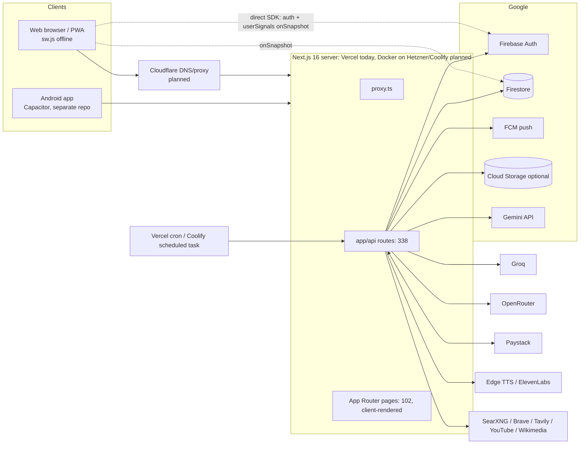
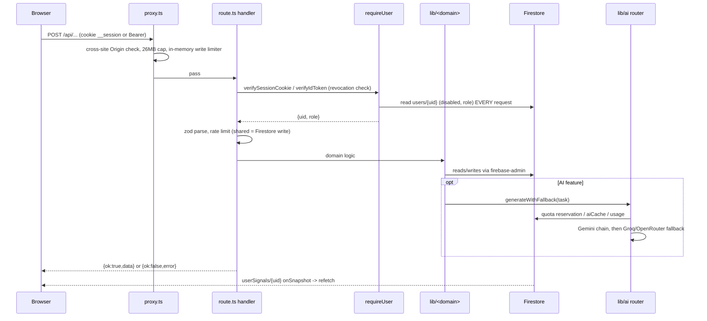
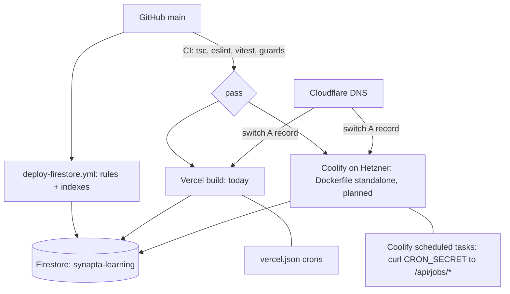

# SunRoot System Map

Audit slice: system architecture map. Read-only discovery of `shamzrepha/synapta` at commit `e3eb258` (worktree HEAD). Method: `find`, `grep`, `wc`, reading source. Nothing was built, run or called over the network. Env var NAMES only.

Confidence key: HIGH = read directly in code/tests; MEDIUM = inferred from several files; LOW = inferred from one signal; UNKNOWN = not establishable from the repo.

---

## 1. Project root, frameworks, structure

**Finding.** Single Next.js app (not a monorepo), npm, Node 24, App Router, Firebase as the only datastore.
**Evidence.** `package.json` (name `sunroot`, `engines.node >=24.12.0`), `.nvmrc` = `24`, single `package-lock.json`, no `workspaces` key, no `pnpm-lock`/`yarn.lock`. Dockerfile and CI both use `node:24`/`node-version: 24`.
**Status.** Verified. **Confidence.** HIGH.

| Item | Value (source: package.json) |
|---|---|
| Next.js | 16.4.3 (`proxy.ts` replaces `middleware.ts`; the Next 16 convention) |
| React / DOM | 19.3.0 |
| TypeScript | ^5, Tailwind ^4 (via `@tailwindcss/turbopack`), Turbopack rule in `next.config.ts` |
| Firebase | `firebase` 13.0.0 (client), `firebase-admin` 14.5.0 (server, in `serverExternalPackages`) |
| AI SDK | `@google/genai` 2.28.0 only. Groq and OpenRouter are called by hand-written HTTP clients (`lib/ai/groq.ts`, `lib/ai/openrouter.ts`), no SDK |
| State/data | `zustand` 5.0.15, `@tanstack/react-query` 5.104.1, `react-hook-form` 7.89.0 + `@hookform/resolvers`, `zod` 3.25.76 |
| UI | `framer-motion` 14, `lucide-react`, `class-variance-authority`, `clsx`, `tailwind-merge`, `recharts` 3.10, `canvas-confetti` |
| Content rendering | `react-markdown`, `remark-gfm`, `remark-math`, `rehype-katex`, `katex`, `mermaid` 12.2, `pdfjs-dist` 6.4, `pdf-lib` |
| 3D / sim / code | `three` 0.186, `blockly` 13.4, `js-interpreter` 6.0.2 |
| Learning algos | `ts-fsrs` ^5.4.2 (spaced repetition); `lib/bkt`, `lib/fsrs`, `lib/adaptive` hold in-house logic |
| Native | `@capacitor/core` ^8.6, `@capgo/capacitor-social-login` (only the web-side bridge; the Android project is in a separate `sunroot-mobile` repo per CLAUDE.md) |
| TTS | `edge-tts-universal` ^1.4 |
| Test | `vitest` ^5.0.3 (no jsdom/testing-library in deps; DOM tests exist, see section 2) |

**Top-level tree (tracked files, depth 1-2).**

```
app/                 Next App Router: (app) authed shell, (auth) login/signup, (marketing) landing, about/, download/, r/[token], api/
  api/               338 route.ts files
components/          197 .tsx files, ~30 domain folders (ui, shell, providers, labs, studio, lesson, teach, bot, ...)
lib/                 353 non-test .ts/.tsx modules, ~75 domain folders (ai, auth, studio, worlds, study, teacher, billing, ...)
public/              sw.js, sw-policy.js, firebase-messaging-sw.js, sim/ (three.min.js, simkit3d.js), pitch/ (82 MB), landing/, 2 APKs, llms.txt
scripts/             acceptance-b14.ts, check-list-guards, check-no-hardcoded-models, check-openrouter-models, eval-tutor, release-app, smoke, migrate-teacher-enrollments, purge-demo-data, build-sim-three
prompts/ subject-packs/ fixtures/   Worlds prompt and Subject Pack files read at runtime (see outputFileTracingIncludes in next.config.ts)
types/               shared ambient types
docs/                ADMIN_GUIDE, DECISIONS, DEPLOY (duplicate of root DEPLOY.md), FEATURE-BUILD-GUIDE, OPENROUTER, PROGRESS, RELEASING, SELF-HOSTING; subfolders ai/, antigravity/, design/, marketing/, worlds/
firestore.rules (257 lines)  firestore.indexes.json (430 lines)  firebase.json
Dockerfile (54)  vercel.json (2 crons)  next.config.ts  proxy.ts (117)  vitest.config.mts  eslint.config.mjs
.agent/ (5,181 tracked files, ~120 MB)   .claude/ (skills)   .github/workflows/{ci,deploy-firestore,security-review}.yml
ANTIGRAVITY_CRITICAL_FIXES_AND_ROADMAP.md (758 lines)  AGENTS.md  CLAUDE.md  DEPLOY.md  README.md
```

**Generated/ignored dirs.** `.next/`, `node_modules/` (not tracked). Standalone output is produced only when `SELF_HOST=1` (set in Dockerfile). Evidence: `next.config.ts`, Dockerfile. HIGH.

**Test locations.** 232 `*.test.ts(x)` files outside `.agent/` and `node_modules`, co-located with source (no `__tests__` tree). Densest: `app/api` (21), `lib/studio` (18), `lib/ai` (17), `lib/study` (13), `lib/teacher` (11), `lib/worlds` (9), `lib/pet` (9). Component tests are few (`components/teach/blocks.test.tsx`, `components/study/flipbook-notes.test.tsx`, `components/lesson/find-block-dom.test.ts`). Many routes have no test of their own; the safety net is `app/api/route-guards.test.ts` (a source-text scan). HIGH for counts, MEDIUM for "most routes untested" (21 route tests vs 338 routes is directly visible).

**CI.** `.github/workflows/ci.yml` runs `npm run verify` = `tsc --noEmit && eslint . && vitest run && check:guards && check:models && test:acceptance`, with mock Firebase env. It does NOT run `next build`. So a build break is first seen on Vercel/Coolify. (HIGH; ci.yml read lines 1-50; I did not read the rest of the file, so a later build step is possible but `verify` itself contains none.)

---

## 2. Size and largest files

| Metric | Count | Method |
|---|---|---|
| API routes (`app/api/**/route.ts`) | 338 | `find` |
| Pages (`page.tsx`) | 102 | `find app` |
| Layouts | 3 (root, `(app)`, `classes/[classId]`) | `find` |
| `loading.tsx` / `error.tsx` | 1 / 1 (+ `global-error.tsx`, `not-found.tsx`) | `find` |
| lib modules (non-test) | 353 | `find lib` |
| components (.tsx) | 197 | `find` |
| Tests | 232 | `find` |
| TS/TSX LOC (tracked, excl. `.agent`) | ~155,700 | `wc -l` |
| Firestore top-level collections touched via `adminDb().collection(...)` | ~70 distinct literal names (users and classes dominate: 124 and 88 call sites) | `grep -o` |
| Firestore rules `match` blocks | 36 | `grep -c` |

Largest files (LOC, all verified with `wc -l`):

| File | LOC | What it does |
|---|---|---|
| `app/(app)/admin/page.tsx` | 1909 | Single-file admin console (users, billing, AI, system) |
| `app/(app)/classes/[classId]/past-questions/page.tsx` | 1826 | Past-exam-question UI |
| `app/(app)/notebook/page.tsx` | 1519 | NotebookLM-style source chat/studio |
| `app/(app)/classes/[classId]/read/page.tsx` | 1450 | Class reader (hosts InteractiveNote) |
| `app/(app)/schools/page.tsx` | 1304 | Schools/principal UI |
| `lib/ai/router.ts` | 1227 | `generateWithFallback`: model chains, quota, provider fallback, JSON repair; the AI core |
| `components/lesson/interactive-note.tsx` | 1129 | Interactive lesson/note renderer |
| `lib/studio/templates.ts` | 1088 | Maker Studio design templates (data) |
| `components/study/kinetic-formula.tsx` | 1022 | Animated formula component |
| `app/(app)/studio/[id]/page.tsx` | 1003 | Studio design editor page |
| `components/bot/bot-provider.tsx` | 929 | "Sprout" mascot provider (global overlay state) |
| `app/api/schools/route.ts` | 609 | One route handling most of the schools domain |
| `app/api/classes/[id]/past-questions/route.ts` | 607 | Past questions API |

**Finding.** Page files of 800-1900 lines are the norm for feature pages (admin, classes, notebook, schools). Business logic is split reasonably into `lib/`, but UI, data fetching and state live together in giant client pages. Impact: hard to review, test (no component tests), or split by team. Recommendation: for new work, put logic in `lib/<domain>` + a hook, and keep pages under ~300 lines. Confidence HIGH.

---

## 3. API routes (338), by domain

Counted by first path segment under `app/api/` (HIGH; `find app/api -name route.ts`).

| Category | Count | Prefixes (example paths) |
|---|---|---|
| Classes (core LMS + learning engine) | 55 | `classes/[id]/kcs/[kcId]/{lesson,practice,simulation,quests,pieces,labs,audio,content/generate,publish}`, `classes/[id]/{join,roster,materials,syllabus/generate,build,map,heatmap,assignments,proposals,replan,past-questions,diagnostic/start}` |
| Studio (maker/3D/circuit) | 30 | `studio/designs/[id]/{ai,commits,fork,revert,wall,collaborators}`, `studio/{parts,paths,contests,plan,research,ideas,templates,videos}` |
| Admin | 30 | `admin/{users,billing/*,system/*,worlds/ai/*,alerts,audit,broadcast,devices,usage,reports,site,autonomous}` |
| Study tools | 15 | `study/{notes,exams,mistakes,glossary,daily,dna,evaluation,telemetry,term,terms}` |
| Worlds (new content-pack engine) | 14 | `worlds`, `worlds/[worldId]/{nodes,queue,tutor,progress,map,images,conflicts}`, `worlds/{advance,docs,from-library,report}` |
| Me / profile / game | 10 + 3 | `me/{dashboard,learner-state,profile,settings,usage,game,achievements,push-token,request-teacher}`, `profile/setup`, `pet`, `streak` |
| Social feed | 10 | `feed`, `feed/[postId]/{like,react,repost,vote,bookmark,comments}` |
| Events / challenges | 9 | `events/[eventId]/{join,next,answer,submit,submit-design,vote,finalize}` |
| Communities, groups, friends, chats, messages | 8 + 3 + 3 + 7 + 1 | `communities/*`, `groups/*`, `friends/*`, `chats/[chatId]/{messages,members,typing,read,...}` |
| Lounge (study rooms) and focus | 7 + 4 | `lounge/rooms/[roomCode]/*`, `lounge/match`, `focus/rooms/*` |
| Sessions, attendance, announcements | 6 + 5 + 4 | `sessions/[sessionId]/{join,rsvp,ics}`, `attendance/*`, `announcements/*` |
| Notebooks (two systems) | 6 + 4 | `notebooks/[notebookId]/{sources,messages,share}` and legacy-looking `notebook/{chat,artifacts,discussion,voice}` |
| Tutors, mentors, ask | 5 + 5 + 5 | `tutors/requests/*`, `mentors/requests/*`, `ask/[id]/{accept,replies,upvote}` |
| Flashcards, mindmap, polls, plans, grading | 5, 4, 5, 4, 4 | `flashcards/*`, `mindmap/{generate,explain}`, `plans/generate`, `grading/[id]/{override,submit}` |
| Billing | 4 | `billing/{checkout,verify,webhook,me}` (Paystack) |
| AI direct | 3 | `ai/{tutor,quiz,flashcards}`; plus `stt`, `tts`, `tts/read` |
| Auth | 3 | `auth/{session,bootstrap,restore}` |
| Jobs/cron | 3 | `jobs/{streak-reminders,session-reminders,resume}` + `goals/reminders` |
| Infra | 4 | `health`, `version`, `client-errors`, `media/[...path]`, `avatar/[uid]` |
| Small singletons (~35 routes at 1-2 each) | ~60 | `schools`, `search`, `snap`, `quiz/[sessionId]/answer`, `papers`, `leaderboard`, `shop/*`, `evidence`, `experiments/runs`, `labs/verify`, `i18n/ui`, `images/search`, `documents/read`, `institutions/inquiry`, `referrals`, ... |

**Public (unauthenticated) routes**, enforced as an allow-list in `app/api/route-guards.test.ts` (`PUBLIC_ROUTES`): `health`, `version`, `client-errors`, `auth/session`, `auth/bootstrap`, `auth/restore`, `billing/webhook`. A scan found 10 routes without `requireUser`; the extra three (`jobs/streak-reminders`, `jobs/session-reminders`, `goals/reminders`) pass the test via the `CRON_SECRET` regex. HIGH.

**Finding.** The guard test is a regex over source text (`GUARDS`), a presence check, not a semantic one. A route that merely mentions `getCaller` in a comment passes. Also `jobs/resume` is listed in CI env comments but I did not verify what it does. Status: Verified (test read). Impact: guard coverage is good-faith, not proof; the security slice should sample routes. Confidence HIGH for the mechanism.

**Observation on cohesion.** `classes/*` (55 routes) is the real product; `studio/*` (30) and `admin/*` (30) are the next biggest. Studio and Worlds are large parallel subsystems (section 5).

---

## 4. Frontend architecture

### 4.1 Layouts and route groups
- `app/layout.tsx` (root): fonts (Instrument Sans/Serif, IBM Plex Mono), providers: `ThemeProvider`, `QueryProvider`, `AuthProvider`, `ToastProvider`, `RealtimeProvider`, `ClientErrorListener`, `KeyboardGuard`, `PageTranslator`. HIGH.
- `app/(app)/layout.tsx`: authed shell. Wraps in `BotProvider`, renders `AuthGuard`, skip-link, `Sidebar`, `Topbar`, `MobileNav`, `HubTabs`, banners (`VerifyEmailBanner`, `SiteNotice`, `AppUpdateBanner`, `NewVersionWatcher`, `UpgradeDialog`), and 10+ global overlays (`CommandPalette`, `TutorLauncher`, `OverlayCalculator`, `OfflineManager`, `ThemeApplier`, `AccessibilityApplier`, `DeviceReporter`, `ProfileSetup`, `AddMaterialSheet`). HIGH. Impact: every authed page mounts all of these; the shell has real cost and many always-on listeners (Recommendation: audit bundle and listener cost).
- `app/(auth)/{login,signup}`, `app/(marketing)/page.tsx` (landing), plus `about/`, `download/`, `r/[token]` (shared report links), `manifest.ts`, `robots.ts`, `sitemap.ts`, `opengraph-image.tsx`.
- `app/(app)/classes/[classId]/layout.tsx`: class-scoped layout (the only nested layout).

### 4.2 Server vs client components
**Finding.** The app is almost entirely client-rendered. 283 files under `app/` and `components/` carry `"use client"`; of the page files, only `community/page.tsx` and `study/page.tsx` lack it (verified by `grep -L`). Data is loaded client-side after mount through `fetchJson` (`lib/api/client.ts`, a thin `fetch` wrapper returning `{ok,data}|{ok:false,error}`) inside `useEffect`s. Impact: no streaming/SSR benefit for authed pages, every page is gated on client auth state (AuthProvider) before it can fetch, SEO irrelevant for authed pages anyway. Confidence HIGH (counts) / MEDIUM (the useEffect pattern was sampled, not exhaustively verified).

### 4.3 State and data fetching
- **Zustand: exactly one store**, `lib/store/use-user-store.ts` (user profile, sidebar collapse, role type `UserRole = "student" | "teacher" | "admin"`). HIGH (grep for `from "zustand"` returned one file).
- **TanStack Query: installed and provided (`components/providers/query-provider.tsx`, staleTime 60s) but never used.** `grep useQuery|useMutation` over `app components lib` returned 0 files. This is an unused dependency and an unused provider. HIGH.
- **react-hook-form + @hookform/resolvers: installed, 0 uses** (`grep useForm|react-hook-form` over `app components` = 0). Forms are hand-rolled with `useState`. HIGH.
- **Zod** is used server-side: 210 route files contain `z.object`. Client-side validation is ad hoc.
- **Realtime:** `components/providers/realtime-provider.tsx` listens to a single Firestore doc `userSignals/{uid}` (written only by the server) and bumps a version counter; pages refetch on signal. Direct client Firestore `onSnapshot` appears in only 3 files (`realtime-provider`, `lib/live/client.ts`, `lounge/[roomCode]/page.tsx`). Everything else goes through API routes. This is a deliberate "server is the only writer, client reads signals" design. HIGH.
- **Providers of note:** `AuthProvider` (Firebase client auth: email, Google popup/redirect, custom token, native Google via Capacitor; syncs the `__session` cookie through `/api/auth/session`), `BotProvider` (the Sprout mascot: floating pet, read-along hop, focus mood, calculator; 929 lines), `ThemeProvider`.

### 4.4 Shared UI worth reusing
- `components/ui/`: `avatar, badge, button, card, input, textarea, skeleton, toast, flip-card, read-aloud, error-boundary` (11 primitives; small set, cva-based).
- `components/shell/`: `hub.tsx`/`hub-tabs.tsx`/`page-tabs.tsx` (section tabs), `nav-items.ts` (the nav registry; edit this to add a destination), `command-palette.tsx`, `add-material.tsx` (global "add material" sheet), `feature-icon.tsx`.
- `lib/features/registry.ts` and `intents.ts`: a feature registry (verified to exist with tests; I did not read contents, so how it relates to `nav-items.ts` is UNKNOWN).
- Domain components: `components/labs/*`, `components/studio/*` (viewer3d, circuit-bench, blockly-editor, sim-stage), `components/lesson/interactive-note.tsx`, `components/teach/blocks.tsx`, `components/study/*`, `components/billing/upgrade-dialog.tsx` (global upgrade pop-up triggered by `lib/billing/upgrade-event.ts` when an API returns an upgrade code, a neat cross-cutting pattern).
- Design rules: `docs/design/DESIGN-SYSTEM.md`, `.claude/skills/anti-slop-playbook/SKILL.md` (per CLAUDE.md; brand-* not teal-*).

### 4.5 Error handling, loading, protection
- Error boundaries: `app/error.tsx`, `app/global-error.tsx`, `components/ui/error-boundary.tsx` (used in only `lounge/page.tsx`). Client errors reported to `/api/client-errors` via `ClientErrorListener`. Loading states: one root `loading.tsx`; per-page skeletons are ad hoc (`components/ui/skeleton.tsx`). Weak coverage: most pages depend on page-local loading flags. MEDIUM.
- **Route protection is two-layer and both layers are weak-ish by design:** (1) `proxy.ts` redirects to `/login?redirect=` when a protected prefix is hit without a `__session` cookie. It checks cookie PRESENCE only, not validity (cannot verify a Firebase cookie in the proxy without admin SDK). `/admin` only checks that a cookie exists; the real admin check happens in the API (`requireUser(req, ["admin"])`) and probably in the page. (2) `components/auth/auth-guard.tsx` (client) bounces if Firebase has no user. So the page shell of any protected route loads for anyone holding any cookie; data is protected only by API checks. That is acceptable only because pages hold no server-rendered data. HIGH (proxy.ts and auth-guard read).
- `protectedPrefixes` in `proxy.ts` is a hard-coded list of 40 prefixes. New top-level authed routes must be added by hand or they are unprotected at the proxy layer (they are still behind AuthGuard and API checks). Notably absent from the list: `/worlds`, `/schools`, `/offline`. Status: Verified (list read). Impact: `/worlds` and `/schools` pages are not gated at the proxy; client AuthGuard still redirects. Recommendation: derive the list from the `(app)` group or invert it (public allow-list).

### 4.6 Proxy API guard (security-relevant for this slice)
`proxy.ts` runs for all `/api/*`: cross-site write refusal by `Origin` vs `Host`, 26 MB body cap by declared `content-length`, and an in-memory per-instance rate limit (240 writes/min signed-in, 60 anonymous; key = last 24 chars of credential or IP from `x-forwarded-for`). `lib/rateLimit.ts` offers a second limiter with a `shared: true` Firestore-backed mode for costly routes (162 route files reference rate-limit helpers). HIGH. Caveat: behind Cloudflare/Coolify, `x-forwarded-for` trust and per-instance memory limits are deployment-dependent (UNKNOWN whether Cloudflare overwrites it correctly here).

### 4.7 Mobile responsiveness and accessibility
- Responsive: Tailwind breakpoints (`sm/md/lg`), `MobileNav` bottom bar, safe-area padding `pb-[calc(5.5rem+env(safe-area-inset-bottom))]`, `viewportFit: cover`, `interactiveWidget: resizes-content`, `KeyboardGuard`. HIGH.
- Accessibility signals: skip-to-content link and `id="main-content"` in `(app)/layout.tsx`, `AccessibilityApplier` (user prefs), 170 files with `aria-` attributes. No axe/a11y test tooling found. Status: Partially verified; actual WCAG conformance UNKNOWN.
- i18n: `lib/i18n` (translate, `useT`, `PageTranslator`, `/api/i18n/ui`), but `useT` is used in only 5 files (HIGH, grep); the UI is mostly English strings with machine page-translation layered on top (MEDIUM).

### 4.8 Offline and caching
- `public/sw.js` (118 lines, cache version `v4`) + `public/sw-policy.js` (38): app-shell precache of `/offline`, static assets, and a non-versioned `sunroot-downloads` cache for user downloads; never touches non-GET, cross-origin or auth endpoints. Policy tested in `lib/offline/sw-policy.test.ts`. `components/offline/{offline-manager,use-offline,download-button}.tsx` + `lib/offline/items.ts` implement "download a note for offline". `app/(app)/offline` page exists. HIGH.
- Other caching: Next router cache `staleTimes {dynamic:120, static:300}` (`next.config.ts`), Firestore caches (`aiCache`, `contentCache`, `ttsCache`, `videoCache`), `Cache-Control` on media/avatar/tts routes. QueryClient cache effectively unused (see 4.3).
- Push: `public/firebase-messaging-sw.js`, `/api/me/push-token`, VAPID env. A separate CSP extension applies for the push worker (`lib/security/push-worker-csp.test.ts`).
- Offline for lab/sim iframes, AI features: not offline-capable (obviously); how well offline note downloads work in practice is UNKNOWN (no production access).

### 4.9 How a NEW feature should be added (recommendation, derived from the repo's own conventions)
1. **API:** `app/api/<domain>/route.ts`; `requireUser(req)` or `requireUser(req, ["admin"])`; zod `.safeParse` the body; return `{ok,data}` / use `ApiError` and `toErrorResponse` (`lib/api/errors.ts`); add `rateLimit({... shared: true})` if it costs money; confirm `app/api/route-guards.test.ts` passes.
2. **Data:** a `lib/<domain>/store.ts` module owning Firestore access (pattern used by `lib/daily`, `lib/mistakes`, `lib/notebooks`); add rules to `firestore.rules` (default is deny-all at the `{document=**}` match, verify before relying on it) and indexes to `firestore.indexes.json`; deploy-firestore workflow ships them.
3. **AI:** add a task in `lib/ai/tasks.ts` and call `generateWithFallback`; no model names outside `lib/ai` (CI check).
4. **UI:** a page under `app/(app)/<route>`, client component calling `fetchJson`; reuse `components/ui/*`, `PageTabs/Hub`, `toast`; add the route to `nav-items.ts` and `protectedPrefixes` in `proxy.ts`; follow `docs/design/DESIGN-SYSTEM.md`.
5. **Do not introduce a third state/data library:** either adopt TanStack Query properly (already provided) or remove it.
6. **Labs/sims:** see section 5; extend the Studio spec or the HTML-sim path, not a new bespoke component.

---

## 5. Duplicate, obsolete and conflicting implementations

Each row: Finding / Evidence / Status / Impact / Recommendation. Recommendations are mine.

1. **Five parallel "lab" systems on one topic page.**
   - Evidence: `app/(app)/classes/[classId]/topics/[kcId]/page.tsx` imports `LAB_REGISTRY` (hand-coded React labs `ohms_law, rc_filter, logic_gates, projectile, none` in `components/labs/index.ts`), `AiSimulation` (AI-written HTML5 in a sandboxed iframe, `lib/sim/*`, `/api/classes/[id]/kcs/[kcId]/simulation`), `InteractiveStudioLab` (Maker Studio JSON spec renderer, `lib/studio/*`), `PiecesLab` (`lib/sim/pieces.ts`), `TapToEnter`, `ProveIt` (`/api/labs/verify`). Separately `/experiments` + `lib/experiments` + `components/experiments/workbench-game.tsx` is a sixth physics engine (`lib/experiments/physics.ts`), and `/studio` is a standalone maker product (30 API routes). `docs/DECISIONS.md` records the choice "AI-generated HTML5 simulations" AND "Designs are data, not generated HTML", i.e. two opposite philosophies live side by side. Recent commit `3943430` says "labs back to HTML default", confirming churn.
   - Status: Verified (imports, docs). Impact: highest maintenance and cognitive cost in the repo; each has its own grading/verification path. Recommendation: pick HTML-sim as default, treat Studio as an advanced mode, retire the hard-coded four React labs and `/experiments` unless usage data (UNKNOWN, needs production access) shows use. Confidence HIGH on existence, LOW on which are used.
2. **Two notebook systems.** `app/api/notebooks/*` (saved notebooks with sources, sharing, `lib/notebooks/store.ts`) vs `app/api/notebook/{chat,artifacts,discussion,voice}` (+ `lib/notebook/retrieval.ts`, `app/(app)/notebook/page.tsx`, 1519 lines). Likely the second is the chat/studio backend of the first, but boundaries are unclear. Status: Partially verified. Recommendation: document or merge under one prefix.
3. **Community fragmentation.** `communities` (8 routes, page + `[id]`), `community` (a page), `groups` (study groups, `studyGroups` collection), `lounge` (rooms), `focus/rooms`, `chats` plus `direct_chats` plus `messages/[friendUid]`, `ask`, `polls`, `feed`, `shoutouts`. Two DM systems are visible: `/api/messages/[friendUid]` and `/api/chats`; Firestore collections `direct_chats` and `chats` both exist. Status: Verified (routes and collection names); which is legacy is UNKNOWN. `docs/DECISIONS.md` line ~121 says notebook sharing reuses chats "instead of a second chat system alongside Lounge", so the team knows about chat duplication.
4. **Tutor vs tutors.** `/tutor` (AI voice tutor, `app/(app)/tutor/voice`) vs `/tutors` (human peer tutors, `tutorProfiles`, `tutorRequests`) vs `/mentors` (`mentorProfiles`, `mentorRequests`). Naming collision, and tutors vs mentors is two near-identical request/match flows (`tutors/requests/*`, `mentors/requests/*`). Status: Verified. Recommendation: merge peer tutor and mentor flows.
5. **Reader / notes components.** `app/(app)/classes/[classId]/read/page.tsx` (1450 lines) + `components/lesson/interactive-note.tsx` (1129) + `lib/lesson/textbook.ts` vs `app/(app)/study/notes` + `lib/study/notes*.ts` + `components/study/flipbook-notes.tsx` + `lib/study/note-pages.ts`. Two note-rendering stacks (class textbook vs personal study notes). Status: Partially verified (structure seen, not rendering code).
6. **Two Worlds-like content engines.** "Worlds" (`lib/worlds/*`, 14 routes, `subject-packs/`, `prompts/`, spec `docs/worlds/SUNROOT_WORLDS_SPEC.md`) vs the Classes/KC pipeline (`lib/teacher/classBuilder.ts`, `kcStore.ts`, `materialIngest.ts`). Both ingest documents, build a knowledge map, and tutor against it. `docs/worlds/PHASE0_FINDINGS.md` and `DEPLOY-AND-TEST.md` exist; I did not read them. Status: Partially verified. Impact: possible long-term duplication of the ingest-to-map-to-tutor pipeline. UNKNOWN whether Worlds is meant to replace Classes (founder question).
7. **Learning algorithm duplicates.** `lib/fsrs`, `ts-fsrs` dependency, `lib/bkt`, `lib/adaptive`, `lib/practice`, `lib/mistakes`, `lib/daily`, `lib/learning`, `mastery` collection, `learnerProfiles`, `learnerPlans`. Overlap with the learning-engine slice; flagged only. Status: Assumption (not analysed).
8. **Duplicate docs.** `DEPLOY.md` (root, mentions Vercel and "Synapta") vs `docs/DEPLOY.md` (96 lines) vs `docs/SELF-HOSTING.md`. The name "Synapta" persists in root DEPLOY.md, repo name and Firebase project `synapta-learning` while the product is "Sunroot/SunRootLearn" (rename incomplete). Also `ANTIGRAVITY_CRITICAL_FIXES_AND_ROADMAP.md` (758 lines) at root and `docs/antigravity/*` (9 docs, mostly Android/Paystack/push setup despite the name); `scripts/check-list-guards.mjs` AND `.ts` (two copies of one script; package.json uses `.mjs`).
9. **Tracked `.agent/` directory: 5,181 files, ~120 MB.** Contains `skills/impeccable` (4,469 files, with a nested `.agent/skills/impeccable/.agent/...` path), `ui-ux-pro-max` (710), `anti-slop-playbook` (1). CLAUDE.md says third-party packages under `.agent/` must NOT be committed, yet they are tracked (`git ls-files .agent | wc -l` = 5181). Also `public/sunroot-3.2.apk` and `public/sunroot-3.3.apk` (8.9 MB each, identical size) are tracked, contradicting CLAUDE.md "no APK files in public/". Status: Verified. Impact: repo bloat, slow clones and CI checkouts, Docker context (the `.dockerignore` excludes some). Recommendation: `git rm --cached` and ignore; move APKs to GitHub Releases (the app version manifest is `public/app-version.json`). Also `public/pitch/` (82 MB videos/pptx) is tracked.
10. **Duplicate `AGENTS.md` auto-generation block** (`next dev` rewrites it); harmless but noted in CLAUDE.md.
11. **Dead dependency set.** `@tanstack/react-query`, `react-hook-form`, `@hookform/resolvers` (installed, unused, see 4.3); `@capacitor/core` with 15 files referencing capacitor (used, via native-google/app-update). Env-example lists `SENTRY_DSN`, `UPSTASH_REDIS_REST_*` but no Sentry/Upstash code or package exists (grep over app/components/lib/scripts returned 0 files). The audit brief listed Sentry, PostHog and Upstash as integrations: they are NOT integrated in code. HIGH.

---

## 6. Auth, roles, hosting, integrations

### 6.1 Auth and role model
- Client: Firebase Auth (email/password, Google popup/redirect, native Google via `@capgo/capacitor-social-login`, custom token sign-in). `AuthProvider` calls `/api/auth/session` to mint a Firebase **session cookie** named `__session`; `proxy.ts` reads its presence only.
- Server: `requireUser(req, allowedRoles?)` in `lib/auth/requireUser.ts` accepts either `Authorization: Bearer <idToken>` (`verifyIdToken(token, true)`, revocation checked) or the `__session` cookie (`verifySessionCookie(cookie, true)`). It then reads `users/{uid}` from Firestore on EVERY request to check `disabled === true` and to override the role with `users.role`. Privileged paths fail closed with 503 when the user doc cannot be read; learner paths fail open. Returns `{uid,email,role,emailVerified}`. `requireVerifiedEmail(user)` is for UGC. HIGH (file read).
- Roles: `UserRole = "student" | "teacher" | "admin"` (`lib/store/use-user-store.ts`). Custom claims `{role}` are set in `auth/bootstrap`, `admin/users/[uid]`, `me/request-teacher`, but the effective role is the Firestore `users.role` (the claim is only a default). So role revocation is immediate, at the cost of one Firestore read per API call (see section 8). Admin whitelist via env `ADMIN_EMAILS`.
- "Principal/school": `schools` route (609 lines) and `app/(app)/schools` page exist; I did not find a fourth role in `UserRole`, so principals are presumably a school-membership attribute rather than a role (MEDIUM; the security/business slices should confirm).
- Class access: `lib/auth/classAccess.ts`, `enrollments` collection, `classes/[id]/access` route.
- Firestore rules: 257 lines, 36 `match` blocks; `lib/auth/rules.test.ts` and `firestore-rules-file.test.ts` exist. Server is the main writer; clients only read a few docs. Deny-all default `match /{document=**}` at line 7 (rules header read, body not fully verified).

### 6.2 Hosting and deployment
- Current: Vercel (main auto-deploys), `vercel.json` with two crons (`/api/jobs/streak-reminders` 18:00 UTC, `/api/goals/reminders` 07:00 UTC). Firestore rules/indexes deployed by `.github/workflows/deploy-firestore.yml` (existence verified; contents not read).
- Target: Hetzner + Coolify + Cloudflare, documented in `docs/SELF-HOSTING.md` (68 lines) and a multi-stage `Dockerfile` (deps, build, run; Node 24 bookworm-slim; `output: "standalone"` only when `SELF_HOST=1`; non-root user uid 1001; `HEALTHCHECK` on `/api/health`; `NEXT_PUBLIC_*` are build ARGs; `VERCEL_GIT_COMMIT_SHA` repurposed from `SOURCE_COMMIT` for the version watcher). The doc itself says "Nothing here has been run on a real server yet" and notes the build needs 8 GB RAM.
- Gaps for self-hosting (verified from docs/code): crons must be re-created in Coolify (documented, includes `/api/jobs/session-reminders` optionally); `jobs/resume` has no documented schedule (UNKNOWN purpose); `public/pitch` (82 MB) and APKs are excluded from the image by `.dockerignore`, and links to them will break unless moved; no per-branch previews; in-memory rate limiter is per instance (fine for one container, resets on restart); `public/sw.js` and `app-version.json` are static; no Redis. Firebase (Auth + Firestore + possibly Storage) stays on Google, so a self-hosted app server still has a hard dependency on Google Cloud from Hetzner (latency from Hetzner region to Firestore region is UNKNOWN; check the Firestore location).
- `next.config.ts` CSP has `connect-src` limited to `googleapis`, `firebaseio`, `identitytoolkit`, `securetoken`, `generativelanguage` and `'unsafe-inline'`/`'unsafe-eval'` on scripts (needed by sim/Blockly/mermaid probably). Cloudflare Rocket Loader, Auto-minify or caching of `/api` could break it; documented advice is "do not cache /api/*".

### 6.3 Integrations (verified by code or env names)

| Integration | Evidence | Notes |
|---|---|---|
| Firebase Auth, Firestore, FCM, Storage (optional) | `lib/firebase/{admin,client}.ts`, `lib/media/store.ts` (Storage bucket if exists, else Firestore `media/` docs up to 700 KB), `firebase-messaging-sw.js` | Storage fallback logic means image persistence behaviour depends on project plan (UNKNOWN in prod) |
| Gemini | `@google/genai`, `GEMINI_*` env family (chains, RPD limits), `lib/ai/router.ts`, `lib/ai/models.ts` | Chains and per-task model overrides |
| Groq | `lib/ai/groq*.ts`, `GROQ_API_KEY`, admin routes `admin/system/groq-*` | No SDK |
| OpenRouter | `lib/ai/openrouter*.ts`, `OPENROUTER_API_KEY`, spend tracking `aiSpend`, `docs/OPENROUTER.md` | Admin can set keys from the UI; keys stored in Firestore `secrets` collection (5 call sites) rather than env only |
| Paystack | `lib/billing/paystack.ts`, `billing/{checkout,verify,webhook}`, `PAYSTACK_SECRET_KEY`, HMAC signature check | Plan limits in `lib/billing/plans.ts`, enforced by `BILLING_ENFORCED` or admin setting |
| Edge TTS | `edge-tts-universal`, `lib/ai/voice*.ts`, `SPROUT_READ_VOICE`, `VOICE_ENGINE` | Unofficial Microsoft Edge endpoint; reliability/licensing risk (assumption) |
| ElevenLabs | `ELEVENLABS_API_KEY` env read in code | Optional TTS path |
| Web search | `SEARXNG_URL`, `BRAVE_SEARCH_API_KEY`, `TAVILY_API_KEY`, `YOUTUBE_API_KEY`, Wikimedia/Openverse (`images/search`, `studio/parts/photos`) | Several overlapping search backends |
| Capacitor | `@capacitor/core`, `@capgo/capacitor-social-login`, `lib/native/app-update.ts`, `lib/auth/native-google.ts` | App shell lives in a separate repo (`sunroot-mobile`) |
| Sentry, PostHog, Upstash | NOT in code or `package.json`; only `SENTRY_DSN`/`UPSTASH_*` names in `.env.example` and SELF-HOSTING.md | Observability is home-grown: `client-errors` route, `errorLogs`, `auditLogs`, `aiHealth`, `deviceStats` collections |

Env var names read by code (no values): `ADMIN_EMAILS, BILLING_ENFORCED, BRAVE_SEARCH_API_KEY, CRON_SECRET, ELEVENLABS_API_KEY, FIREBASE_ADMIN_{CLIENT_EMAIL,PRIVATE_KEY,PROJECT_ID}` (+ legacy `FIREBASE_{CLIENT_EMAIL,PRIVATE_KEY,PROJECT_ID}`), `GEMINI_API_KEY, GEMINI_{CHAIN_HEAVY,CHAIN_LIGHT,FALLBACK_CHAIN,MODEL,MODEL_BUILD,MODEL_FALLBACK,MODEL_GRADING,MODEL_LONGDOC,MODEL_OVERFLOW,MODEL_STRUCTURED,MODEL_TUTOR,MODEL_VOICE,RPD_LIMITS}, GROQ_API_KEY, NEXT_PUBLIC_{APP_URL,BUILD_ID,FIREBASE_*,GOOGLE_SITE_VERIFICATION,GOOGLE_WEB_CLIENT_ID}, OPENROUTER_API_KEY, PAYSTACK_SECRET_KEY, SEARXNG_URL, SELF_HOST, SPROUT_READ_VOICE, STUDENT_TOKEN_LIMIT, TAVILY_API_KEY, TEACHER_TOKEN_LIMIT, VERCEL_GIT_COMMIT_SHA, VOICE_ENGINE, YOUTUBE_API_KEY`. Not listed in `.env.example` though read by code: `BRAVE_SEARCH_API_KEY, ELEVENLABS_API_KEY, GROQ_API_KEY, TAVILY_API_KEY, YOUTUBE_API_KEY, VOICE_ENGINE, NEXT_PUBLIC_GOOGLE_WEB_CLIENT_ID, GEMINI_FALLBACK_CHAIN`. Hosting migration risk: a Coolify env copy based on `.env.example` or SELF-HOSTING.md would miss these. HIGH.

---

## 7. Diagrams

### 7.1 System context



### 7.2 Request flow



### 7.3 Deployment (current and planned)



---

## 8. Synthesis

### 8.1 Ten most important files
1. `proxy.ts` - redirect gating, CSRF-style origin check, size cap, write rate limit.
2. `lib/auth/requireUser.ts` - the single auth gate; per-request Firestore read.
3. `lib/ai/router.ts` (1,227 lines) - all AI calls, chains, quota, fallback.
4. `lib/ai/tasks.ts` - AI task registry (CI-enforced entry point).
5. `firestore.rules` (+ `firestore.indexes.json`) - client-side security boundary and query support.
6. `app/(app)/layout.tsx` - the authed shell and everything mounted globally.
7. `components/providers/auth-provider.tsx` + `use-user-store.ts` - client identity.
8. `lib/teacher/classBuilder.ts` / `kcStore.ts` / `materialIngest.ts` - the material-to-curriculum pipeline (names verified; contents not read).
9. `app/api/route-guards.test.ts` - the structural security net.
10. `Dockerfile` + `next.config.ts` + `docs/SELF-HOSTING.md` - the migration path and the CSP.

### 8.2 Five most complicated subsystems
1. **AI router and quota** (`lib/ai/*`, `lib/quota/*`, `aiUsage/aiSpend/aiHealth/quotaReservations`): multi-provider chains, RPD limits, dynamic model config from Firestore (`systemConfig`), admin-managed keys.
2. **Maker Studio** (`lib/studio/*`, 18 test files, circuit netlist, Blockly to Arduino JS, 3D viewer, robot physics, parts datasheet library, contests, commits/forks): effectively a second product.
3. **Class build pipeline** (`lib/teacher/*`, `lib/classes/*`, 55 class routes): ingest material, build KC graph, proposals, publish, lessons, simulations, quests, replans.
4. **Worlds** (`lib/worlds/*`, subject packs, prompts, conformance tests): a parallel content-pack engine.
5. **Lesson/reader/audio stack** (`components/lesson/interactive-note.tsx`, `lib/lesson/audio.ts`, TTS caches, read-along, the Sprout bot): heavy client logic.

### 8.3 Strengths (verified unless marked)
- Consistent API envelope `{ok,data|error}` and error class (`lib/api/errors.ts`, `lib/api/client.ts`).
- CI-enforced architectural rules: route guards, no hardcoded model names, list guards (`check-list-guards`), 232 tests, `verify` script.
- Server is the only writer for most data; client reads minimal docs: small attack surface on Firestore.
- Thoughtful security detail: session cookie revocation checks, fail-closed for privileged paths, cross-site write refusal, body cap, webhook HMAC.
- Pre-wired for self-hosting (standalone output, healthcheck, non-root, cron doc).
- Good decision log (`docs/DECISIONS.md`).

### 8.4 Weaknesses
- Scope sprawl: 338 routes, ~70 collections, social network + LMS + maker studio + exam prep + worlds in one codebase by what looks like a very small team; duplicate subsystems (section 5).
- Unused libraries (TanStack Query, react-hook-form); no shared data-fetching layer: 113 files call `fetchJson`, 151 files call raw `fetch("/api...`, each page re-implements loading/error.
- Mega-pages (1,000-1,900 lines), almost no component tests.
- Client-only rendering for the entire product; auth gating partly client-side.
- Tracked bloat (`.agent`, APKs, pitch videos) against the team's own rules.
- Rename debt (Synapta vs Sunroot), duplicate docs, stale env documentation.
- CI lacks `next build`; no E2E tests (`test:acceptance` is a script, `scripts/acceptance-b14.ts`, content not read).
- Observability is home-grown; no tracing/alerting vendor in code.

### 8.5 What would break at 10,000 students (HYPOTHESIS, reasoned from code, not load-tested)
1. **Firestore read amplification from `requireUser`.** One extra `users/{uid}` read per API request, plus the page-level fetch fan-out of a client-rendered app (each page makes several calls). At 10k students with, say, a few hundred requests per active student per day, this is millions of reads per day. Cost and latency, not correctness. Mitigation (recommendation): cache role/disabled per instance for 30-60 s or put them in the verified claim with revocation check.
2. **Shared Firestore rate limiter** (`rateLimit.ts` with `shared: true`, one Firestore write per call, collection `rateLimits`): hot-key contention and write cost on costly routes; the `quotaReservations` pattern likewise. Single-doc counters cap around 1 write/s/doc.
3. **Per-instance in-memory limiter** (`proxy.ts`): with one Hetzner container fine; with two it halves effectiveness; resets on every deploy/restart. At exam-time bursts on a single 8 GB server, Node memory for `hits` Map and SSR is small, but the single process is the SPOF (SELF-HOSTING.md itself says ~20,000 users is the limit for one server).
4. **AI cost and quota exhaustion.** Gemini RPD limits env-configured; with 10k students concurrent tutor chats exhaust free-tier chains; the router has fallback to Groq/OpenRouter but latency and cost spike. Spend is tracked (`aiSpend`) and an OpenRouter daily limit exists (docs), so failure is graceful degradation (`AiQuotaExhaustedError`) rather than a crash. Heavy generation done synchronously inside HTTP requests (class build has `buildJobs` and `jobs/resume`, others may not) risks 60-300 s requests; on self-hosted Node there is no Vercel function timeout but Cloudflare's proxy timeout (100 s on non-Enterprise plans) applies. MEDIUM.
5. **Big documents in memory.** PDF parsing (`pdfjs-dist`, `pdf-lib`, `documents/read`, uploads up to 26 MB through the proxy) on a single Node process: a handful of concurrent large uploads can exhaust memory (the doc already notes the build needs 8 GB). Firestore `media` fallback stores images as docs, with a 700 KB cap.
6. **Leaderboards and fan-out writes** (`leagueEntries`, `leagueCohorts`, `weeklyBoards`, feed posts, `userSignals` bump per event): each XP/notification event writes a signal doc; per-user doc writes are fine, but hot docs (global leaderboard, `systemConfig`, `hashtagStats` trending) can hit the 1 write/s/doc limit. UNKNOWN without reading the code; flagged for the DB slice.
7. **Realtime:** each open client keeps one `userSignals` listener (cheap) plus occasional room/notebook listeners; 10k concurrent listeners are within Firestore limits but cost reads on every signal.
8. **Composite indexes and unbounded list queries:** `check-list-guards` suggests the team already guards against unbounded lists (script purpose inferred from its name, not read). 430 lines of index config; missing indexes only fail at runtime.
9. **Cron on Coolify** (`curl` inside the container): reminders across 10k users in one request may exceed request time; `jobs/resume` hints at batching but I did not verify.
10. **Operational:** a single Coolify box, no staging, no preview deploys, no APM; migration risk is the dominant one, not scale.

---

## Open questions

| # | What is missing | Why it matters | Who can answer | Evidence that resolves it |
|---|---|---|---|---|
| 1 | Production traffic: active users, requests/day, reads/writes per day per collection | All 10k-student statements are hypotheses; sizing of Hetzner box and Firestore bill | Founder / production access (Firebase usage, Vercel analytics) | Firebase console usage tab, Vercel analytics export |
| 2 | Which lab systems and which routes are actually used (classic labs, `/experiments`, Studio, Worlds, communities, mentors vs tutors) | Decides what to delete; section 5 is code-only | Founder / production access | Firestore counts per collection, request logs per route |
| 3 | Is Worlds intended to replace the Classes pipeline? | Determines duplicate-pipeline severity | Founder | Product decision, `docs/worlds/*` (not read by me) |
| 4 | Which DM system (`chats` vs `direct_chats`/`messages`) and which notebook API (`notebook/*` vs `notebooks/*`) is canonical | Data migration and cleanup | Founder / DB-API slice | Client call sites and live collection contents |
| 5 | Contents of `.github/workflows/{deploy-firestore,security-review}.yml` and whether CI runs `next build` | Deploy safety | Repo reading by another slice | Full workflow files |
| 6 | Firestore region and Storage bucket existence in production | Latency from Hetzner, and whether `media/` images live in Storage or Firestore docs | Production access (Firebase console) | Project settings |
| 7 | Role "principal" implementation | Authorization model for schools | Security/business slices, founder | `app/api/schools/route.ts`, rules for school collections |
| 8 | Behaviour of `x-forwarded-for` and Origin/Host through Cloudflare + Coolify (Traefik) | Rate limiter keying and the cross-site check (`Host` header must equal the public host) can break after migration | Whoever deploys (external test) | A test deployment on `test.sunrootlearn.com` |
| 9 | Purpose and schedule of `jobs/resume` and of `scripts/acceptance-b14.ts` | Part of the `verify` gate and cron migration | Repo reading by another slice | Read both files |
| 10 | Whether sentry/upstash/PostHog were ever intended or are used outside this repo (e.g. Vercel integrations) | Brief lists them; code has none | Founder | Vercel integrations page, `SENTRY_DSN` in Vercel env |
| 11 | Real accessibility and offline quality | Only signals were checked | External testing | Lighthouse/axe run, device tests |
| 12 | Whether `.agent/` and the APKs were intentionally force-added | Contradicts CLAUDE.md | Founder | Commit history for those paths |
